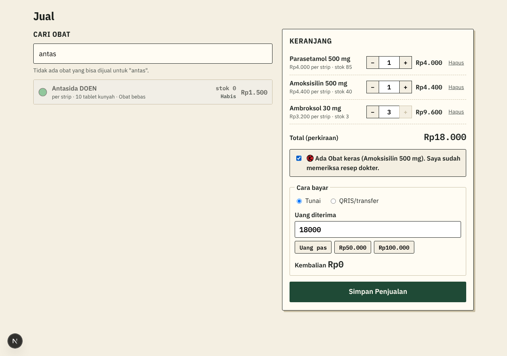

# Penjelasan kode: Mencatat Penjualan (tiket #8)

> Dokumen ini menjelaskan kode tiket #8 untuk orang yang belum pernah membuat aplikasi web. Istilah domain (Penjualan, Keranjang, Item penjualan, Cara bayar, Cek resep) mengikuti [`CONTEXT.md`](../../CONTEXT.md). Istilah teknis lain ada di kamus [`KENAPA.md`](../KENAPA.md#kamus-istilah-teknis). Keputusan penguncian stok ada di [ADR 0005](../adr/0005-kunci-baris-obat-saat-penjualan.md).



## 1. Ini aplikasi apa: toko online atau catatan kasir?

**Catatan kasir.** Pembeli datang ke apotek dan membayar di meja kasir. Kasir mengetik obat yang dibeli di layar Jual, lalu ApotikKu:

- mengambil harga dari database,
- mengecek stok, kedaluwarsa, dan resep,
- menghitung total dan kembalian,
- mengurangi stok,
- memberi Nomor Penjualan (PJ-000123).

Pembeli tidak pernah menyentuh layar ini. Pengunjung di internet hanya bisa **melihat** Katalog (ADR 0002). *Analogi:* mesin kasir minimarket. Pembeli tidak memakainya; kasir yang memakai, dan hasilnya catatan penjualan.

## 2. Siapa mengerjakan apa

| Bagian | File | Tugas | Boleh salah? |
|---|---|---|---|
| Layar Jual | `app/staf/jual/LayarJual.tsx` | Mencari obat, menyusun Keranjang, menghitung **perkiraan** total dan kembalian, menampilkan pesan | Boleh. Semua angkanya dicek ulang database |
| Server Action | `app/staf/jual/aksi.ts` | Meneruskan Keranjang (hanya obat + jumlah) ke database, lalu meminta daftar stok dimuat ulang | Boleh. Tidak ada aturan yang dipercayakan ke sini |
| **Fungsi database** | `catat_penjualan` di `supabase/migrations/…_penjualan.sql` | Mengecek semua aturan, mengunci stok, menyimpan, mengurangi stok | **Tidak boleh.** Karena itu diuji otomatis |

*Analogi:* restoran. Pelayan (layar) mencatat pesanan dan memperkirakan harganya. Kasir restoran (Server Action) meneruskan pesanan ke dapur. **Kepala dapur** (fungsi database) yang memutuskan: bahan ada atau tidak, harga resmi berapa, dan hanya dia yang boleh mengambil bahan dari gudang.

Kenapa tidak cukup di layar? Kunci Supabase di browser bersifat publik (ADR 0003). Orang yang paham teknis bisa melewati layar dan mengirim perintah sendiri, misalnya "jual Amoksisilin seharga Rp1". Fungsi database mengabaikan harga apa pun yang dikirim dan mengambil harga sendiri.

## 3. Isi fungsi `catat_penjualan`, langkah demi langkah

```
Keranjang [{obat 12, jumlah 2}, {obat 7, jumlah 1}], Tunai, uang 20.000, Cek resep: ya
   │
   1. Pemanggil Staf aktif?                      tidak → "Akun ini tidak bisa mencatat Penjualan."
   2. Keranjang kosong? Cara bayar benar?
      Obat dikenal? Jumlah ≥ 1?                  tidak → pesan
   3. KUNCI baris obat 7 lalu 12 (urut id)       ← bagian 4
   4. Untuk setiap obat: diarsipkan? kedaluwarsa? habis? stok cukup?
   5. Ada Obat keras tapi Cek resep tidak dicentang?
   6. Tunai: uang ≥ total?  QRIS/transfer: uang diterima kosong?
   7. Simpan Penjualan + Item penjualan (harga DARI DATABASE), kurangi stok
   │
   └─▶ { nomor: "PJ-000123", total: 12000, kembalian: 8000, item: [...] }
```

Kalau ada satu saja langkah yang gagal, fungsi berhenti dengan **`RAISE EXCEPTION`** (berhenti sambil membawa pesan). Karena semua langkah berjalan dalam satu **transaksi database**, berhenti di tengah berarti **semua yang sudah terjadi dibatalkan**. Hasilnya: tidak ada Penjualan setengah jadi, dan stok obat lain di Keranjang tidak ikut berkurang (NF-06, "utuh atau tidak sama sekali").

*Analogi:* menulis dengan pensil. Selama transaksi belum selesai, semua tulisan masih pensil. Begitu ada yang salah, semuanya dihapus. Hanya bila semua langkah lolos, tulisannya ditebalkan dengan tinta.

Pesannya ditulis dalam bahasa sehari-hari dan menyebut obatnya, misalnya **"Stok Ambroksol 30 mg tinggal 3 strip."** Layar menampilkannya apa adanya, dan Keranjang tetap ada, jadi Kasir cukup mengubah jumlahnya lalu menyimpan lagi. Daftar lengkap pesannya ada di SPEC 4.4.

## 4. Penguncian stok: bagaimana dua Kasir tidak menjual obat terakhir dua kali

Stok Amoksisilin tinggal **1 strip**. Kasir 1 dan Kasir 2 menekan Simpan pada detik yang sama.

**Tanpa kunci** (yang dicegah):

```
Kasir 1: baca stok → 1, cukup ✓ ............ kurangi → 0
Kasir 2: baca stok → 1, cukup ✓ ............ kurangi → −1   ✗ terjual 2, padahal hanya ada 1
```

Keduanya membaca angka yang sama sebelum ada yang mengurangi. Ini disebut **race condition** (kondisi balapan). *Analogi:* dua loket bioskop menjual kursi terakhir yang sama.

**Dengan kunci** (yang kami pakai):

```
Kasir 1: KUNCI Amoksisilin → baca 1 ✓ → simpan → kurangi → 0 → selesai, kunci lepas
Kasir 2: KUNCI Amoksisilin → (menunggu…) ──────────────────────────▶ baca 0 → "Stok Amoksisilin 500 mg habis."
```

Perintahnya `SELECT … FOR UPDATE`: "ambil baris ini dan tandai sedang saya pakai". Transaksi lain yang ingin memakai baris yang sama harus **menunggu** sampai transaksi pertama selesai. *Analogi:* kamar pas di toko baju. Selama ada orang di dalam, pintunya terkunci, dan orang berikutnya menunggu di depan.

Tunggunya hanya hitungan milidetik, dan **hanya untuk obat yang sama**. Kasir yang menjual obat lain tidak ikut menunggu.

**Kenapa dikunci urut id obat?** Misalkan Kasir 1 membeli Obat A lalu B, sedangkan Kasir 2 membeli B lalu A. Tanpa urutan, Kasir 1 bisa memegang A sambil menunggu B, dan Kasir 2 memegang B sambil menunggu A. Keduanya menunggu selamanya. Ini disebut **kebuntuan (deadlock)**; *analogi:* dua mobil berhadapan di jalan sempit, masing-masing menunggu yang lain mundur. Kalau semua Kasir selalu mengunci dari id terkecil, mereka antre dengan urutan yang sama, jadi kebuntuan tidak mungkin terjadi.

## 5. Harga yang tersimpan tidak ikut berubah

Setiap Item penjualan menyimpan **salinan** harga saat terjual (`harga_satuan`), bukan rujukan ke harga obat sekarang. Kalau besok Admin menaikkan harga Parasetamol, Penjualan kemarin tetap tercatat dengan harga lama (NF-06). *Analogi:* struk belanja kemarin tidak berubah walau label harga di rak diganti hari ini.

Bila harga berubah **saat Kasir sedang melayani** (Admin mengubah harga tepat sebelum Kasir menekan Simpan), Penjualan tetap tersimpan dengan harga database. Panel hasil lalu menampilkan kotak kuning: "Harga Parasetamol 500 mg sudah berubah: Rp4.000 → Rp4.500. Total memakai harga terbaru. Beri tahu pembeli." Kalau uang tunainya jadi kurang, database menolak dan menyebut total barunya.

## 6. Siapa boleh melihat apa

| | Pengunjung | Kasir | Admin |
|---|:-:|:-:|:-:|
| Memanggil `catat_penjualan` | ❌ (ditolak di pintu) | ✅ | ✅ |
| Membaca Penjualan | ❌ | Miliknya, **hari ini** (WIB) | Semua |
| Membaca Item penjualan | ❌ | Bila Penjualannya terlihat | Semua |
| Menulis langsung ke tabel Penjualan (tambah, ubah, hapus) | ❌ | ❌ | ❌ |

Kenapa Kasir hanya melihat Penjualan miliknya hari ini? Daftar semua Penjualan sama saja dengan laporan pendapatan, dan laporan adalah wewenang Admin (SPEC 4.5). Kenapa Admin pun tidak bisa menghapus? Penjualan tidak pernah dihapus, hanya **dibatalkan** dengan jejak siapa, kapan, dan kenapa (aturan bisnis 7, tiket #13).

## 7. Cara bayar: kenapa ada QRIS padahal tidak tersambung bank?

Pilihan "QRIS/transfer" hanya **catatan**. Aplikasi tidak menampilkan kode QR dan tidak mengecek uang masuk; pembeli memindai QR yang sudah ditempel apotek di meja kasir.

Gunanya: **uang QRIS masuk ke rekening, bukan ke laci.** Saat tutup toko, uang di laci harus sama dengan total Penjualan **tunai**. Kalau Penjualan QRIS tercatat sebagai tunai, laci selalu tampak "kurang", Kasir yang jujur bisa dicurigai, dan kekurangan yang sungguhan malah tersamar. Sumber dan angka QRIS di usaha kecil ada di [`riset/cara-bayar-qris.md`](../riset/cara-bayar-qris.md).

## 8. Layar Jual: dirancang untuk cepat

Target NF-03: Penjualan 3 obat selesai ≤ 30 detik.

- Kotak cari langsung aktif saat halaman dibuka. Ketik "para", tekan **Enter**, dan obat pertama yang bisa dijual masuk Keranjang. Obat Habis tetap terlihat (abu-abu) supaya Kasir bisa memberi tahu pembeli, tetapi Enter melewatinya.
- Setiap hasil menampilkan **stok persis** ("stok 12") dan Status stok. Obat Habis atau Sudah kedaluwarsa tidak bisa dipilih.
- Jumlah diubah dengan − / + atau diketik, dan tidak bisa melebihi stok yang terlihat.
- Bila ada Obat keras, kotak "Saya sudah memeriksa resep dokter" muncul, dan tombol Simpan baru aktif setelah kotak itu dicentang.
- Cara bayar bawaan **Tunai**, dengan tombol cepat Uang pas / Rp50.000 / Rp100.000. Kembalian langsung terlihat. Enter di kolom uang = Simpan.
- Setelah berhasil: Keranjang kosong, panel hasil menampilkan Nomor Penjualan dan kembalian, daftar stok diperbarui, dan kotak cari aktif lagi untuk pembeli berikutnya. Struk dibuat di tiket #10.

Daftar obat diambil dari tampilan **`obat_kasir`**. Tampilan ini memakai fungsi Status stok yang sama dengan Katalog, jadi "Hampir habis" di layar kasir dan di Katalog tidak mungkin berbeda. Tampilan ini juga berjalan dengan hak si pembaca (*security invoker*), sehingga Pengunjung dan Staf nonaktif mendapat daftar kosong.

## 9. Bagaimana kami mengujinya

Tes otomatis ada di [`tests/penjualan.test.ts`](../../tests/penjualan.test.ts) dan berjalan di GitHub Actions setiap ada Pull Request. Tes berperan sebagai Kasir, Admin, Staf nonaktif, dan Pengunjung, lalu memanggil database **persis seperti layar Jual**. Yang diuji:

- **Berhasil:** stok berkurang, total dan kembalian benar, harga dari database.
- **Harga dari layar diabaikan:** dikirim "harga Rp1", yang tersimpan tetap Rp2.500.
- **Semua alasan penolakan,** dengan pesan diuji kata per kata. Setelah setiap penolakan, stok dipastikan tidak berubah.
- **Utuh atau tidak sama sekali:** Keranjang berisi satu obat valid dan satu obat Habis ditolak seluruhnya, stok obat yang valid tidak berkurang, dan tidak ada Penjualan baru.
- **Dua Kasir bersamaan:** Kasir uji dan Admin uji menjual obat ber-stok 1 pada saat yang sama, diulang 3 ronde. Setiap ronde harus tepat satu yang berhasil, dengan stok akhir 0.
- **Harga tercatat:** mengubah harga setelah Penjualan tidak mengubah Penjualan lama.
- **Hak akses:** Pengunjung tidak bisa memanggil fungsinya, Kasir tidak bisa menulis langsung ke tabel, dan Kasir tidak melihat Penjualan Kasir lain maupun Penjualan kemarin.

**Supaya tes bisa diulang:** setiap tes mengurangi stok, padahal Kasir tidak boleh mengubah obat. Project uji (dan **hanya** project uji) punya fungsi `uji_atur_obat` yang mengembalikan stok dan harga obat `uji-jual-*` ke angka awal sebelum setiap tes. *Analogi:* tombol reset di mesin latihan, yang tidak dipasang di mesin sungguhan. Fungsi ini dipasang lewat `supabase/uji/data-uji.sql`, bukan migrasi, jadi tidak pernah ada di database asli.

Sebelum tes jalan di CI, fungsi juga dicoba langsung di database uji sebagai Kasir uji, di dalam transaksi yang sengaja digagalkan di akhir (*rollback*), sehingga percobaannya tidak meninggalkan jejak.

## Kalau dosen bertanya…

**"Bagaimana kalau dua kasir menjual obat terakhir di detik yang sama?"**
Fungsi database mengunci baris obat itu sebelum membaca stok. Kasir kedua menunggu sepersekian detik, lalu membaca stok 0 dan ditolak "Stok … habis". Ada tes otomatis yang menjalankan dua penjualan serentak tiga kali, dan selalu tepat satu yang berhasil.

**"Kenapa total di layar disebut 'perkiraan'?"**
Karena harga resmi diambil database saat menyimpan (aturan bisnis 6). Layar menghitung dari daftar yang dimuat saat halaman dibuka; kalau Admin mengubah harga sesudahnya, angka resmi bisa berbeda, dan layar memberi tahu Kasir.

**"Kenapa Penjualan tidak disimpan langsung dari browser ke tabel?"**
Karena aturannya bisa dilewati, dan langkahnya bisa putus di tengah: Penjualan tersimpan tetapi stok belum berkurang. Kasir tidak punya izin menulis ke tabel sama sekali. Satu-satunya pintu adalah fungsi `catat_penjualan`, yang berjalan dalam satu transaksi.

**"Kalau fungsi database itu berjalan dengan hak penuh (security definer), bukankah berbahaya?"**
Fungsi itu memang perlu hak lebih, karena Kasir tidak boleh menulis ke tabel secara langsung. Bahayanya dijaga tiga cara: fungsi mengecek sendiri bahwa pemanggilnya Staf aktif, Pengunjung tidak diberi izin memanggilnya sama sekali, dan semua nama tabel ditulis lengkap (`search_path` kosong) supaya tidak bisa dibelokkan ke tabel tiruan. Pemeriksa keamanan Supabase memberi peringatan untuk fungsi seperti ini, dan peringatan itu disengaja.

**"Kenapa pesan kesalahannya tidak teknis?"**
Kasir bukan programmer (NF-03). "Stok Ambroksol 30 mg tinggal 3 strip" langsung memberi tahu apa yang harus dilakukan. Pesan dari database ditampilkan apa adanya, jadi aturan dan pesannya ada di satu tempat.

**"Kenapa ada fungsi khusus di database uji? Bukankah database uji harus sama dengan yang asli?"**
Bentuk tabel, fungsi, dan aturan keduanya sama persis, karena dipasang dari migrasi yang sama. Yang berbeda hanya **data uji** dan satu alat bantu uji, yang dipasang terpisah lewat `data-uji.sql`. Tanpa alat itu, tes Penjualan hanya bisa dijalankan beberapa kali sebelum stok uji habis.

**"Ini pembelian online?"**
Bukan. Layar Jual dipakai Kasir di meja apotek untuk mencatat pembeli yang datang langsung. Pemesanan online tidak dikerjakan (PRD bagian 9).
