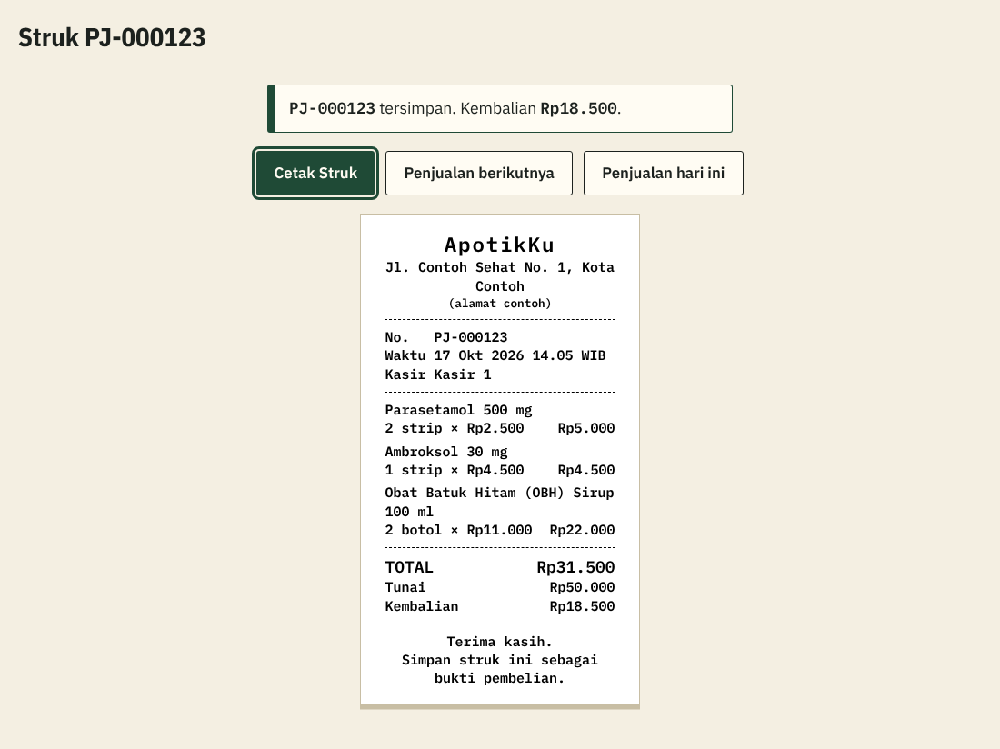
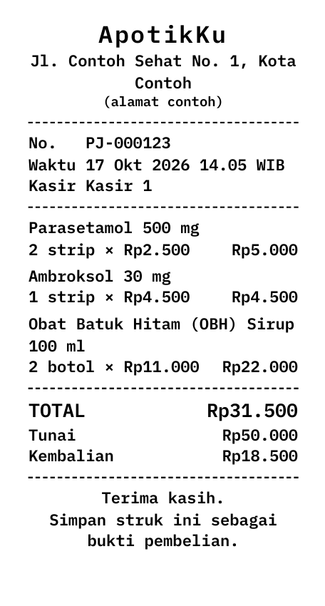
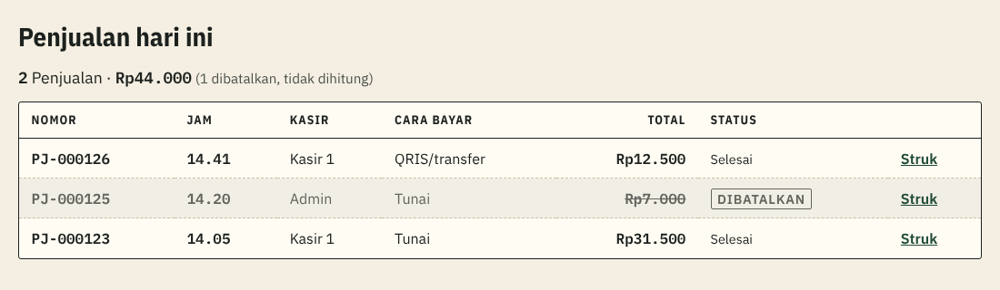

# Penjelasan kode: Struk dan Penjualan hari ini (tiket #10)

> Dokumen ini menjelaskan kode tiket #10 untuk orang yang belum pernah membuat aplikasi web. Istilah domain (Penjualan, Struk, Item penjualan, Pembatalan) mengikuti [`CONTEXT.md`](../../CONTEXT.md). Istilah teknis lain ada di kamus [`KENAPA.md`](../KENAPA.md#kamus-istilah-teknis). Keputusan lengkapnya ada di [SPEC 4.9](../SPEC.md#49-struk-dan-laporan-cetak).

## 1. Apa yang dibangun

Dua halaman, untuk dua masalah dari PRD:

| Halaman | Alamat | Masalah yang diselesaikan |
|---|---|---|
| **Struk** | `/staf/penjualan/PJ-000123/struk` | Pembeli butuh bukti pembelian (F-07, user story 41) dan kadang meminta struk lagi (user story 42) |
| **Penjualan hari ini** | `/staf/penjualan` | Kasir ingin mengecek pekerjaannya hari ini (F-08, user story 43); Admin ingin memeriksa semua Kasir (user story 63) |

## 2. Alur Kasir: dari Simpan sampai Struk tercetak

1. Kasir menekan **Simpan** (atau Enter) di layar Jual.
2. Database mencatat Penjualan (sama seperti #8).
3. **Bila harga tidak berubah**, layar langsung pindah ke halaman Struk. Di atasnya ada kotak besar "PJ-000123 tersimpan. Kembalian Rp18.500", supaya Kasir tetap tahu berapa kembaliannya.
4. Tombol **Cetak Struk** sudah terpilih (*terfokus*), jadi Kasir cukup menekan **Enter**. Dialog cetak browser terbuka, lalu Enter lagi untuk mencetak.
5. Setelah mencetak, tombol **Penjualan berikutnya** yang terpilih. Enter sekali lagi membawa Kasir kembali ke layar Jual.

*Analogi:* mesin kasir minimarket. Setelah total dibayar, kertas struk keluar, lalu kasir langsung melayani pembeli berikutnya tanpa berpindah tangan dari keyboard.

**Bila harga ternyata berubah** (Admin mengubah harga saat Kasir sedang melayani), layar **tidak** langsung pindah. Kotak kuning "Harga … sudah berubah" dari #8 tetap tampil, ditambah tombol **Buka Struk** yang sudah terpilih. Alasannya: pemberitahuan itu hanya ada di memori layar Jual. Kalau layar langsung pindah, pemberitahuannya hilang sebelum dibaca, padahal Kasir perlu memberi tahu pembeli bahwa totalnya berubah.

**Kenapa dialog cetak tidak langsung muncul sendiri?** Dialog yang tiba-tiba muncul mengejutkan, dan tidak semua pembeli meminta struk. Cukup satu Enter.

## 3. Struk 58 mm: bagaimana halaman web dicetak di kertas kasir

Printer kasir memakai **gulungan kertas selebar 58 mm**. Printer seperti ini hanya bisa mencetak selebar **±48 mm**; sisanya pinggiran yang tidak terjangkau kepala printer. Karena itu Struk ditata selebar 48 mm dengan jarak 5 mm di kiri dan kanan.

Aturan tampilan khusus cetak (CSS cetak) mengatur tiga hal:

- **Pita hijau, menu, judul, dan tombol disembunyikan.** Yang tercetak hanya Struk.
- **Huruf monospace 8 pt**, yaitu huruf yang setiap karakternya sama lebar. Angka harga jadi lurus berjajar, sama dengan konsep "etiket" di ADR 0004.
- **Ukuran kertas 58 mm.**

*Analogi:* pengaturan mesin fotokopi. Kita memilih ukuran kertas dan bagian mana yang ikut difotokopi; dokumen aslinya tidak berubah.

**Masalah tinggi kertas.** Gulungan kertas panjangnya bebas, tetapi browser butuh ukuran halaman yang pasti. Kami mencobanya di Chromium:

| Yang ditulis | Hasilnya |
|---|---|
| `58mm auto` (tinggi mengikuti isi) | Ditolak, jatuh ke kertas Letter (21,6 × 27,9 cm) |
| `58mm` saja | Kertas persegi 58 × 58 mm, Struk terpotong ke halaman kedua |

Jalan keluarnya: **sesaat sebelum mencetak**, halaman mengukur tinggi Struk lalu menjadikannya tinggi kertas, ditambah 6 mm supaya mudah disobek. Browser memberi tanda `beforeprint` tepat sebelum mencetak, termasuk bila Kasir menekan Ctrl+P sendiri. Kodenya di `TombolCetak.tsx`. Struk contoh dengan tiga obat menjadi kertas 58 × 108 mm.

**Struk di layar = Struk di kertas, hanya lebih besar.** Semua ukuran di dalam Struk ditulis relatif terhadap ukuran huruf (satuan `em`). Di layar hurufnya 15 px supaya mudah dibaca, di kertas 8 pt. Karena semuanya ikut membesar atau mengecil bersama, letak baris di layar persis sama dengan hasil cetak. *Analogi:* foto yang diperbesar; isinya sama, hanya ukurannya beda.

**Struk Penjualan yang Dibatalkan** mendapat kotak besar **DIBATALKAN** di bagian atas, tebal dan hitam-putih supaya tetap jelas di printer kasir. Pembatalan sendiri baru dibangun di tiket #13, tetapi tampilannya sudah disiapkan.

**Alamat apotek** ditulis "Jl. Contoh Sehat No. 1, Kota Contoh" dengan keterangan "(alamat contoh)", karena ApotikKu bukan apotek sungguhan (SPEC 7). Alamat disimpan di satu file, `lib/apotek.ts`.

## 4. Siapa boleh membuka Struk yang mana

Halaman Struk **tidak mengecek sendiri** siapa pemilik Penjualan. Yang menjaga adalah RLS di database dari #8 (ADR 0003):

| Siapa | Struk yang bisa dibuka |
|---|---|
| Kasir | Penjualan miliknya, hari ini saja |
| Admin | Semua Penjualan, termasuk kemarin |
| Pengunjung | Tidak ada (belum login, diarahkan ke halaman masuk) |

Bila Kasir mengetik alamat Struk milik Kasir lain, database tidak memberikan datanya. Halaman lalu menampilkan **"Penjualan tidak ditemukan."**, pesan yang sama dengan nomor yang memang tidak ada. Dengan begitu orang juga tidak bisa menebak nomor mana yang sungguh ada.

*Analogi:* loket arsip. Petugas hanya menyerahkan map milik kamu; kalau kamu menyebut nomor map orang lain, jawabannya "tidak ada", bukan "ada tapi bukan punyamu".

**Nama obat yang sudah diarsipkan tetap tampil.** Kasir tidak boleh membaca obat yang diarsipkan (SPEC 4.5). Masalahnya, kalau Admin mengarsipkan obat (tiket #9) siang hari, Struk yang dicetak ulang Kasir sore harinya akan kehilangan nama obat itu. Karena itu nama dan Satuan jual dibaca lewat fungsi kecil `private.obat_untuk_struk` yang berjalan dengan hak pemiliknya (*security definer*). Fungsi itu hanya dipanggil dari tampilan `rincian_struk`, untuk Item penjualan yang memang boleh dibaca si Kasir. Yang terbuka hanya nama dan satuan; stok dan harga acuan tidak.

## 5. Penjualan hari ini

- **Kolom:** Nomor, Jam, Cara bayar, Total, Status, dan tautan **Struk** untuk mencetak ulang. Admin mendapat kolom tambahan **Kasir**, karena ia melihat Penjualan semua Kasir. Urutannya dari yang terbaru.
- **Baris jumlah** di atas daftar: "2 Penjualan · Rp44.000". Penjualan Dibatalkan tetap tampil (abu-abu, totalnya dicoret) karena riwayat tidak boleh hilang (aturan bisnis 7), tetapi tidak ikut dijumlahkan.
- **Hanya hari ini**, tanpa pilihan tanggal. Melihat tanggal lain adalah tugas Laporan (#12).

**Kenapa Kasir boleh melihat jumlah miliknya?** Setiap angka itu sudah terlihat di baris-baris miliknya sendiri; baris jumlah hanya menghemat Kasir dari menjumlah manual. Kasir tetap tidak bisa melihat Penjualan Kasir lain, karena daftar semua Penjualan sama dengan laporan pendapatan, wewenang Admin (SPEC 4.5).

### "Hari ini" dihitung di database

Database punya tampilan baru, `penjualan_hari_ini`. Tampilan (*view*) adalah "jendela" ke tabel yang hanya memperlihatkan baris tertentu. *Analogi:* rak "barang masuk hari ini" di gudang.

Kenapa perlu? RLS mengizinkan Admin membaca **semua** Penjualan sepanjang masa, jadi daftar Admin tetap harus disaring ke hari ini. Penyaringnya ditaruh di database memakai `private.hari_ini()`, fungsi yang sama dengan RLS, kedaluwarsa, dan (nanti) Ringkasan. Aturan "hari ini menurut WIB" jadi tetap ditulis di **satu tempat**. Kalau ditulis ulang di kode Next.js, dua salinan aturan bisa berbeda tanpa ketahuan.

Tampilan ini memakai `security_invoker`, artinya membaca tabel dengan hak si pembaca. RLS tetap berlaku, jadi Kasir tetap hanya melihat miliknya.

**Kenapa WIB penting?** Server database memakai waktu UTC, 7 jam di belakang WIB. Penjualan pukul **00.30 WIB** tanggal 17 tercatat di server sebagai pukul 17.30 tanggal **16**. Kalau "hari ini" dihitung dengan jam server, Penjualan itu masuk ke hari kemarin (user story 72).

## 6. Bagaimana kami mengujinya

**Tes otomatis** ada di [`tests/penjualan-hari-ini.test.ts`](../../tests/penjualan-hari-ini.test.ts) dan berjalan di GitHub Actions setiap ada Pull Request:

- Penjualan pukul 00.30 dan 23.30 WIB hari ini terhitung hari ini; pukul 23.30 WIB kemarin tidak.
- Kasir hanya melihat Penjualan miliknya hari ini; Admin melihat semua Staf beserta nama Kasirnya.
- Kasir bisa mencetak ulang Struk miliknya, termasuk nama obat yang sudah diarsipkan, tetapi tidak bisa membaca Struk milik Staf lain atau Struk kemarin.
- Admin bisa membuka Struk siapa pun, termasuk Penjualan kemarin.
- Pengunjung ditolak; Staf nonaktif mendapat daftar kosong.

**Data uji berjam tetap.** Penjualan yang dicatat di dalam tes selalu berwaktu "sekarang", jadi batas jam tidak bisa diuji dengan cara itu. Database uji (dan **hanya** database uji) menyimpan empat Penjualan uji: Kasir uji pukul 00.30 dan 23.30 WIB hari ini, 23.30 WIB kemarin, serta Admin uji pukul 12.00 WIB hari ini. Jadwal kecil (*pg_cron*) menggeser waktunya setiap menit supaya selalu relatif terhadap hari ini. *Analogi:* petugas yang setiap pagi mengganti kertas tanggal di papan. Tes ini juga tidak mencatat Penjualan baru, supaya tidak mengganggu angka stok tes Penjualan #8 yang berjalan bersamaan.

Sebelum tes jalan di CI, tampilan baru juga dicoba langsung di database uji sebagai Kasir uji dan Admin uji, di dalam transaksi yang sengaja digagalkan di akhir (*rollback*), sehingga percobaannya tidak meninggalkan jejak.

**Tes manual (SPEC 5.4):** tata letak Struk dicek di pratinjau cetak browser dan dari PDF 58 mm. Tampilan tidak diuji otomatis, karena tes tampilan mudah rusak setiap kali desain berubah.

## Kalau dosen bertanya…

**"Kenapa Struk dicetak dari browser, bukan pakai aplikasi printer khusus?"**
Printer kasir 58 mm umumnya dipasang sebagai printer biasa di laptop (lewat driver bawaan pabriknya), sehingga browser bisa mencetak ke sana. Aplikasi atau driver khusus berarti biaya dan pemasangan tambahan di setiap komputer kasir, padahal satu tombol Cetak sudah cukup (NF-07: Rp0).

**"Kalau pembeli minta struk lagi besok, bisa?"**
Kasir hanya bisa mencetak ulang Struk hari ini, karena Kasir hanya melihat Penjualan miliknya hari ini (SPEC 4.5). Admin bisa membuka Struk tanggal berapa pun lewat alamatnya. Ini sengaja: riwayat lengkap adalah wewenang Admin.

**"Bagaimana kalau Kasir mengganti nomor di alamat Struk untuk melihat Penjualan orang lain?"**
Database tidak memberikan datanya (RLS), dan halaman menampilkan "Penjualan tidak ditemukan." Ada tes otomatis untuk itu. Halaman sengaja tidak mengecek sendiri, supaya aturannya hanya ada di satu tempat dan tidak bisa dilewati.

**"Kenapa tinggi kertas diukur pakai kode, bukan ditulis tetap saja?"**
Panjang Struk bergantung pada jumlah obat. Tinggi tetap, misalnya 297 mm, membuat printer kasir mengeluarkan kertas kosong panjang setiap kali mencetak. Sementara "tinggi otomatis" (`58mm auto`) ternyata ditolak Chromium. Kami mengujinya, dan hasilnya tercatat di SPEC 4.9.

**"Kenapa 'hari ini' dihitung di database, bukan di kode halaman?"**
Supaya hanya ada satu aturan "hari ini menurut WIB" yang dipakai RLS, kedaluwarsa, daftar Penjualan, dan nanti Ringkasan. Satu aturan di satu tempat tidak mungkin saling bertentangan, dan bisa dites otomatis (Penjualan 00.30 dan 23.30 WIB).

**"Bukankah fungsi security definer untuk nama obat membuka celah?"**
Yang dibuka hanya nama dan Satuan jual, dan hanya untuk Item penjualan yang memang boleh dibaca si pemanggil, karena fungsi itu dipanggil dari tampilan yang tunduk pada RLS. Fungsi itu ada di skema `private`, jadi tidak bisa dipanggil langsung lewat internet. Nama obat sendiri tidak rahasia; Katalog publik pun menampilkannya.

**"Kenapa Kasir boleh melihat total Penjualannya, padahal pendapatan wewenang Admin?"**
Total itu hanya penjumlahan baris-baris milik Kasir sendiri yang memang sudah ia lihat. Yang menjadi wewenang Admin adalah pendapatan **seluruh** apotek, yaitu Penjualan semua Kasir, dan itu tetap tertutup bagi Kasir.
