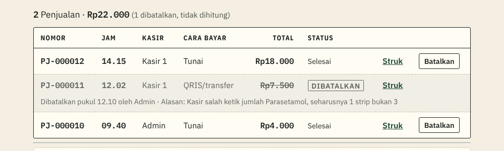
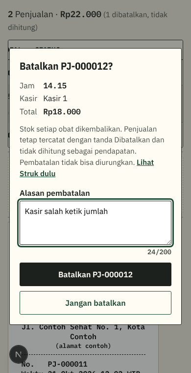
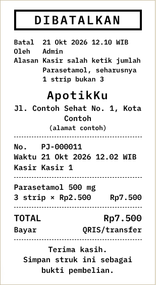

# Penjelasan kode: Pembatalan Penjualan (tiket #13)

> Dokumen ini menjelaskan kode tiket #13 untuk orang yang belum pernah membuat aplikasi web. Istilah domain (Penjualan, Pembatalan, Dibatalkan, Item penjualan) mengikuti [`CONTEXT.md`](../../CONTEXT.md). Istilah teknis lain ada di kamus [`KENAPA.md`](../KENAPA.md#kamus-istilah-teknis). Keputusan lengkapnya ada di [SPEC 4.4](../SPEC.md#44-fungsi-database) dan [SPEC 4.9](../SPEC.md#49-struk-dan-laporan-cetak).

## 1. Masalah yang diselesaikan

Kasir bisa salah: salah ketik jumlah, salah pilih obat, atau pembeli batal membeli setelah Penjualan tersimpan. Penjualan yang salah tidak boleh **dihapus** (aturan bisnis 7: riwayat tidak boleh hilang), tetapi juga tidak boleh tetap dihitung sebagai pendapatan dan mengurangi stok.

Jalan keluarnya adalah **Pembatalan** (F-14, user story 60–62 dan 64):

- Penjualan diberi tanda **Dibatalkan**, beserta kapan, oleh siapa, dan alasannya.
- Stok setiap obat di Penjualan itu dikembalikan.
- Penjualan tetap terlihat, tetapi tidak dijumlahkan.
- **Hanya Admin** yang bisa membatalkan (ADR 0003). Kalau Kasir bisa, ia bisa menerima uang lalu membatalkan Penjualannya sendiri, dan uangnya tidak tercatat.

## 2. Alur Admin

1. Admin membuka **Penjualan hari ini**. Setiap Penjualan yang belum Dibatalkan punya tombol **Batalkan** di ujung kanan.
2. Setelah tombol ditekan, muncul **jendela konfirmasi** di tengah layar (gambar di bawah). Isinya: Nomor Penjualan, jam, Kasir, total, akibat Pembatalan, dan tautan "Lihat Struk dulu" untuk memastikan Penjualan yang dipilih benar.
3. Admin mengetik **alasan** (wajib, paling panjang 200 huruf). Kursor sudah ada di kolom alasan, jadi Admin bisa langsung mengetik.
4. Admin menekan **Batalkan PJ-000012**. Untuk mengurungkan, tekan **Jangan batalkan** atau tombol Esc.
5. Jendela tertutup, daftar dimuat ulang, dan di atasnya muncul pesan, misalnya "PJ-000012 dibatalkan. Stok dikembalikan: Parasetamol 500 mg +2 strip."

> **Jendela modal (`<dialog>`)** = jendela di atas halaman. Selama jendela terbuka, bagian di belakangnya tidak bisa diklik. *Analogi:* petugas bank yang menahan formulir dan bertanya "Yakin?" sebelum mencapnya.

**Kenapa jendela, bukan kotak peringatan bawaan browser (`confirm()`)?** Kotak bawaan tidak bisa diberi kolom alasan, tampilannya tidak bisa diatur, dan bisa dimatikan browser. Panel yang membuka di bawah baris tabel juga ditolak, karena di HP tabelnya bergeser ke samping sehingga panelnya sempit.

**Kenapa tombolnya hitam, bukan merah?** Merah di ApotikKu khusus untuk tanda Obat keras (ADR 0004). Tombol gelap tetap jelas berbeda dari tombol hijau biasa, dan tulisannya menyebut Nomor Penjualan yang akan dibatalkan.

**Bila ditolak** (misalnya alasan kosong, atau Admin lain sudah lebih dulu membatalkan), pesannya tampil di dalam jendela, dan kursor kembali ke kolom alasan.

## 3. Apa yang terlihat setelah dibatalkan

**Di daftar Penjualan hari ini:** baris berwarna abu-abu, total dicoret, status DIBATALKAN, dan di bawahnya ada baris kecil "Dibatalkan pukul 12.10 oleh Admin · Alasan: …". Baris jumlah di atas daftar tidak lagi menghitungnya ("1 dibatalkan, tidak dihitung").

**Di Struk:** tanda besar **DIBATALKAN** (sudah ada sejak #10), sekarang ditambah tiga baris: kapan dibatalkan, oleh siapa, dan alasannya.

**Nama yang membatalkan, kalau yang melihat Kasir:** Kasir tidak boleh membaca profil Staf lain (RLS), jadi database tidak memberinya nama Admin. Layar lalu menulis "oleh **Admin**". Tulisan ini pasti benar, karena hanya Admin yang bisa membatalkan, dan tidak ada data baru yang dibuka.

**Halaman kosong:** di bawah "Belum ada Penjualan hari ini." sekarang ada keterangan kecil "Penjualan hari sebelumnya tetap tersimpan. Admin bisa melihatnya di Laporan." Keterangan ini ditambahkan karena kami sendiri sempat mengira 3 Penjualan kemarin terhapus, padahal hanya bukan "hari ini" lagi.

## 4. Di dalam database: fungsi `batalkan_penjualan`

Seperti Penjualan (#8), Pembatalan hanya bisa lewat **satu fungsi database**, `batalkan_penjualan(nomor, alasan)`, di file migrasi `supabase/migrations/…_pembatalan.sql`. Tidak ada seorang pun, **termasuk Admin**, yang punya izin mengubah tabel `penjualan` secara langsung. Kalau ada, aturan di bawah bisa dilewati lewat DevTools browser.

Langkah fungsi, berurutan. Berhenti di langkah pertama yang gagal, dan semua yang sudah terjadi dibatalkan (**transaksi database**: berhasil semua atau batal semua):

| Langkah | Cek | Pesan bila gagal |
|---|---|---|
| 1 | Pemanggil Admin aktif? | Hanya Admin yang bisa membatalkan Penjualan. |
| 2 | Alasan terisi? (spasi dan baris kosong di ujung dibuang dulu) | Tulis alasan pembatalan. |
| 3 | Alasan paling panjang 200 huruf? | Alasan pembatalan paling panjang 200 huruf. |
| 4 | **Kunci** baris Penjualan, lalu: ada? | Penjualan PJ-000123 tidak ditemukan. |
| 5 | Belum Dibatalkan? | PJ-000123 sudah dibatalkan sebelumnya. |
| 6 | Penjualan hari ini (WIB)? | PJ-000123 bukan Penjualan hari ini, jadi tidak bisa dibatalkan. |
| 7 | **Kunci** baris obat urut id, kembalikan stok, tandai Dibatalkan beserta siapa, kapan, dan alasan | — |

**Kenapa peran dicek paling awal?** Supaya Kasir mendapat pesan yang sama untuk nomor yang ada maupun yang tidak ada. Kalau "tidak ditemukan" dicek lebih dulu, Kasir bisa menebak-nebak nomor mana yang benar-benar ada.

**Kenapa baris Penjualan dikunci?** Bayangkan dua Admin menekan Batalkan untuk Penjualan yang sama pada detik yang sama. Tanpa kunci, keduanya bisa melihat status "Selesai", dan stok kembali **dua kali**. Dengan kunci, Admin kedua menunggu sepersekian detik, lalu melihat status "Dibatalkan" dan ditolak. Stok hanya kembali sekali. Ini diuji otomatis, 3 ronde.

> **Mengunci baris** = menandai satu baris tabel "sedang dipakai" sampai transaksi selesai. *Analogi:* kamar pas toko baju; orang berikutnya menunggu di depan pintu.

**Kenapa baris obat dikunci urut id?** Aturan dari [ADR 0005](../adr/0005-kunci-baris-obat-saat-penjualan.md): semua fungsi yang mengubah stok mengunci obat dengan urutan yang sama. Kalau Pembatalan mengunci obat B lalu A, sementara Penjualan mengunci A lalu B, keduanya bisa saling menunggu selamanya (**kebuntuan**). Dengan urutan yang sama, semuanya antre rapi.

**Kenapa stok tetap kembali walau obatnya sudah diarsipkan atau kedaluwarsa?** Stok adalah jumlah fisik di rak. Strip yang batal dijual memang kembali ke rak, apa pun status obatnya. Arsip hanya menyembunyikan obat dari Katalog dan layar Jual, tidak membuat stoknya nol.

## 5. Kenapa hanya Penjualan hari ini?

Pembatalan di ApotikKu sama dengan *void* di mesin kasir: koreksi **sebelum tutup kasir**. Sistem kasir umum membedakan *void* (sebelum tutup buku hari itu) dan *refund*/retur (transaksi baru setelahnya) ([riset](../riset/pembatalan-hari-ini.md)). Untuk Penjualan kemarin:

- **Obatnya sudah dibawa pulang pembeli.** Kalau stoknya "dikembalikan", angka di aplikasi lebih besar daripada isi rak.
- **Uangnya sudah dihitung**, dan Laporan hari itu mungkin sudah dicetak. Membatalkannya diam-diam membuat Laporan lama berubah.

Pengembalian barang hari sebelumnya (retur) adalah fitur lain: stok masuk dan uang keluar sebagai transaksi baru. Belum ada masalah nyata di PRD yang membutuhkannya, jadi tidak dibuat di versi 1.

## 6. Di dalam kode Next.js

| File | Isi |
|---|---|
| `app/staf/penjualan/page.tsx` | Halaman (di server): membaca `penjualan_hari_ini`, sekarang ditambah kolom `dibatalkan_pada`, `alasan_batal`, `nama_pembatal` |
| `app/staf/penjualan/TabelPenjualan.tsx` | Daftar, tombol Batalkan (hanya Admin), dan jendela konfirmasi. Berjalan di browser karena jendela butuh keadaan (Penjualan mana yang dipilih, alasan, pesan) |
| `app/staf/penjualan/aksi.ts` | **Server Action** `batalkanPenjualan`: meneruskan nomor dan alasan ke `batalkan_penjualan`, lalu memuat ulang daftar (`refresh()`). Tidak ada aturan yang dipercayakan ke sini; semuanya dicek database |
| `app/staf/penjualan/[nomor]/struk/` | Struk membaca kapan, oleh siapa, dan alasan Pembatalan |
| `lib/penjualan.ts` | Bentuk data Pembatalan, batas 200 huruf, dan cara menulis pesan "Stok dikembalikan: …" |

Tombol Batalkan disembunyikan dari Kasir hanya demi kerapian tampilan. **Penjaganya tetap database:** Kasir yang memanggil fungsinya lewat DevTools tetap ditolak, dan itu diuji.

## 7. Tes otomatis (`tests/pembatalan.test.ts`)

Tes memakai tiga obat uji khusus (`uji-jual-batal-a`, `-b`, `-arsip`), terpisah dari obat tes Penjualan. Alasannya: file tes berjalan **bersamaan**, dan tes Penjualan menyetel ulang stok obatnya sendiri sebelum setiap tes. Kalau keduanya memakai obat yang sama, angka stok saling mengganggu. Setiap tes mencatat Penjualannya sendiri lalu membatalkannya. Penjualan uji berjam tetap dari #10 tidak disentuh.

Yang diuji (17 tes):

- Stok setiap Item penjualan kembali; status, siapa, kapan, dan alasan tercatat; total tetap apa adanya.
- Alasan disimpan rapi (tanpa spasi di ujung); tepat 200 huruf diterima, 201 ditolak; kosong ditolak.
- Admin bisa membatalkan Penjualan yang ia catat sendiri; stok obat yang sudah diarsipkan tetap kembali.
- Penjualan Dibatalkan tetap tampil di Penjualan hari ini; Admin melihat nama pembatal, Kasir tidak.
- Ditolak: nomor tidak ada, dibatalkan dua kali (stok hanya kembali sekali), Penjualan hari sebelumnya.
- Dua Admin bersamaan: tepat satu berhasil.
- Kasir, Staf nonaktif, dan Pengunjung ditolak; Admin pun tidak bisa mengubah tabel `penjualan` langsung.

Satu kriteria issue, "Penjualan Dibatalkan tidak dihitung di Ringkasan dan Laporan", baru bisa diuji di #11 dan #12, karena fungsi Ringkasan dan Laporan baru dibuat di sana.

## Kalau dosen bertanya…

**"Kenapa Penjualan tidak dihapus saja kalau salah?"**
Aturan bisnis 7: riwayat tidak boleh hilang. Kalau Penjualan bisa dihapus, orang bisa menerima uang lalu menghapus jejaknya. Dengan Pembatalan, Penjualannya tetap ada, lengkap dengan siapa yang membatalkan, kapan, dan kenapa.

**"Kenapa Admin juga tidak boleh mengubah tabel Penjualan langsung? Admin kan pemilik apotek."**
Supaya semua Pembatalan melewati aturan yang sama: alasan wajib, stok dikembalikan, hanya hari ini, dan dicatat siapa pelakunya. Kalau Admin punya izin mengubah tabel, ia bisa (sengaja atau tidak) mengubah status tanpa mengembalikan stok. Satu pintu berarti satu aturan.

**"Kenapa hanya Penjualan hari ini?"**
Lihat bagian 5: sama dengan *void* di mesin kasir. Obat Penjualan kemarin sudah dibawa pulang dan uangnya sudah dihitung.

**"Bagaimana kalau dua Admin membatalkan Penjualan yang sama bersamaan?"**
Baris Penjualan dikunci. Admin kedua menunggu, lalu ditolak dengan pesan "sudah dibatalkan sebelumnya". Stok hanya kembali sekali. Ada tes otomatis yang mencobanya 3 kali.

**"Kenapa Kasir melihat 'oleh Admin', bukan nama Admin-nya?"**
Kasir tidak diizinkan membaca profil Staf lain (RLS). Karena hanya Admin yang bisa membatalkan, tulisan "Admin" pasti benar. Kami memilih tidak membuka pintu data baru hanya untuk sebuah nama.

**"Kenapa ada batas 200 huruf?"**
Supaya alasan tetap muat di daftar dan di Struk 58 mm. Satu kalimat penjelasan cukup. Batas ini dicek di database, bukan hanya di layar, karena layar bisa dilewati.
