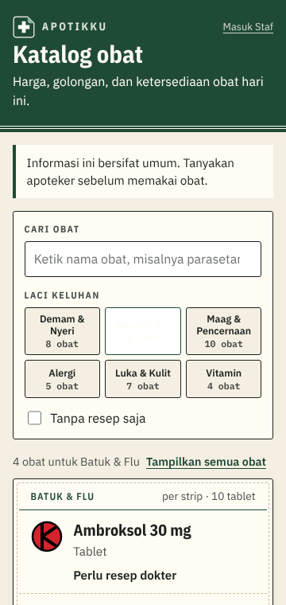
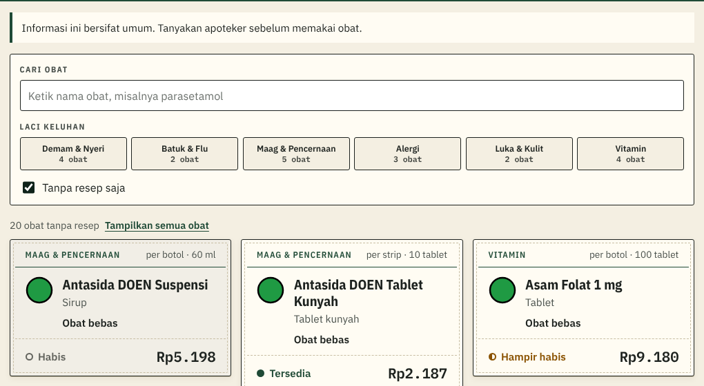
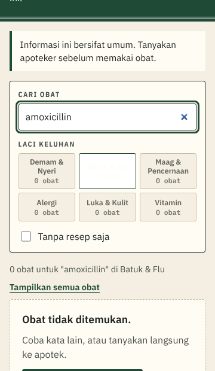

# Penjelasan kode: Cari, laci Keluhan, dan "Tanpa resep" (tiket #4)

> Dokumen ini menjelaskan kode tiket #4 untuk orang yang belum pernah membuat aplikasi web. Istilah domain (Katalog, Keluhan, Obat keras, Status stok) mengikuti [`CONTEXT.md`](../../CONTEXT.md). Istilah teknis lain ada di kamus [`KENAPA.md`](../KENAPA.md#kamus-istilah-teknis). Keputusan lengkapnya ada di [SPEC 4.7](../SPEC.md#47-katalog-dari-prototipe) dan [ADR 0004](../adr/0004-visual-etiket-apotek.md).

## 1. Masalah yang diselesaikan

Sebelum tiket ini, Katalog menampilkan 38 kartu obat sekaligus tanpa cara menyaring. Pengunjung yang hanya ingin tahu harga parasetamol harus menggulir melewati puluhan kartu.

Dari PRD, ada dua tipe Pengunjung (M-07):

- yang **tahu nama obatnya** ("parasetamol") → butuh kotak pencarian;
- yang **hanya tahu keluhannya** ("anak saya batuk") → butuh laci Keluhan.

Target terukurnya: harga sebuah obat ditemukan dalam **≤ 2 langkah** (NF-03). Dengan kotak cari, satu langkah mengetik sudah cukup. Dengan laci, satu ketukan sudah cukup.

Ini menutup F-01 dan F-02, dua baris yang sebelumnya berstatus "Direncanakan" di Matriks Keterunutan SKPL.

## 2. Tiga saringan yang bisa digabung

| Saringan | Cara kerja |
|---|---|
| **Kotak cari** | Mencocokkan **bagian mana pun** dari nama obat, tanpa membedakan huruf besar-kecil. Mengetik "sol" menemukan "Ambrok**sol**" |
| **Laci Keluhan** | Enam laci (3 kolom × 2 baris di HP). Hanya satu laci bisa terbuka; mengetuk laci yang sama **menutupnya** kembali |
| **Tanpa resep saja** | Menyembunyikan Obat keras, yaitu obat yang hanya boleh ditebus dengan resep dokter |

Ketiganya bekerja bersamaan. Jadi "obat batuk yang bisa dibeli tanpa resep, namanya mengandung 'sirup'" bisa ditemukan sekaligus.

**Angka di setiap laci ikut menyesuaikan.** Saat "Tanpa resep saja" dicentang, laci Alergi berubah dari 5 obat menjadi 3 obat, karena 2 di antaranya Obat keras. Jadi Pengunjung tahu apa yang akan ia dapat **sebelum** mengetuk.

**Laci yang kosong dimatikan** (abu-abu, tidak bisa diketuk), supaya tidak ada ketukan yang berujung halaman kosong. Pengecualiannya: laci yang **sedang** terbuka tidak pernah dimatikan, karena kalau dimatikan, saringannya tidak bisa dibatalkan lagi.

## 3. Kalau tidak ada hasil

Pengunjung tidak dibiarkan buntu. Yang muncul: "Obat tidak ditemukan", ajakan mencoba kata lain, **tombol WhatsApp** dengan pesan yang sudah terisi, dan nomor apoteknya dalam bentuk teks biasa supaya bisa disalin kalau tombolnya tidak bekerja.

Pesan awalnya ikut membawa kata yang dicari, misalnya:

> Halo ApotikKu, saya mau tanya apakah ada obat "amoxicillin".

**Nomor WhatsApp disimpan di variabel lingkungan**, bukan di kode (SPEC 4.7), supaya bisa diganti tanpa mengubah program. Kalau belum diisi, aplikasi memakai nomor contoh dan menuliskan "(nomor contoh)" di sebelahnya, jadi tombolnya tidak pernah mati saat demo.

> **Variabel lingkungan** = pengaturan yang dibaca aplikasi saat berjalan, disimpan di luar kode. *Analogi:* PIN brankas yang dihafal penjaga, bukan ditulis di pintu brankas.

Di atas daftar juga ada tombol **"Tampilkan semua obat"** yang membatalkan ketiga saringan sekaligus. Tombol ini hanya muncul saat ada saringan yang aktif.

## 4. Kenapa penyaringan dikerjakan di HP, bukan di database

Ini keputusan terpenting di tiket ini.

Semua obat (38 baris) **dikirim sekali** oleh server saat halaman dibuka. Sesudah itu, setiap ketikan dan setiap ketukan laci diproses **di dalam HP Pengunjung**, tanpa bertanya lagi ke database.

*Analogi:* seperti membawa pulang satu katalog kertas. Setelah katalognya di tangan, membolak-balik halaman tidak perlu menelepon tokonya lagi.

**Kenapa begitu?**

- **Hasilnya seketika.** Tidak ada jeda menunggu jaringan setiap kali mengetik satu huruf. Ini langsung mendukung NF-05 (Katalog terbuka < 3 detik di 4G) dan NF-03 (≤ 2 langkah).
- **38 obat itu kecil.** Seluruh daftarnya hanya beberapa puluh kilobyte, jauh lebih ringan daripada satu foto.
- **Hemat.** Supabase paket gratis punya batas jumlah permintaan. Mengetik "parasetamol" bisa berarti 11 permintaan database kalau disaring di server.

**Yang ditolak:** menyaring di database (setiap ketikan mengirim pertanyaan baru; terasa tersendat di 4G, dan boros kuota gratis). Pilihan ini baru perlu ditinjau ulang kalau obatnya kelak ribuan, dan itu tercatat di SPEC 4.7.

Konsekuensinya satu: komponen penyaring harus berjalan di browser, yaitu **Client Component**.

> **Client Component** = bagian halaman yang kodenya ikut dikirim ke HP dan berjalan di sana, sehingga bisa menanggapi ketikan dan ketukan. Lawannya **Server Component**, yang disusun di server lalu dikirim sebagai HTML jadi. *Analogi:* Server Component seperti makanan matang yang diantar; Client Component seperti alat masak yang ikut dipinjamkan.

Pembagian tugasnya:

| File | Berjalan di | Tugas |
|---|---|---|
| `app/page.tsx` | Server | Mengambil 38 obat dari database, menyusun kepala halaman |
| `components/KatalogTersaring.tsx` | Browser (HP) | Menyimpan keadaan saringan, menyaring daftar, menampilkan kartu |
| `lib/apotek.ts` | Keduanya | Nomor WhatsApp dan pembentuk tautannya |

Karena `lib/apotek.ts` ikut dipakai kode browser, file itu **tidak boleh** memuat kode khusus server. Next.js menolak membangun aplikasi kalau aturan ini dilanggar.

## 5. Bisa dipakai tanpa mouse

Semua kontrolnya memakai elemen HTML asli: `<input type="search">`, `<button>`, dan `<input type="checkbox">`. Akibatnya semuanya otomatis bisa dijangkau dengan tombol Tab dan dijalankan dengan Enter atau spasi, dan tanda fokus hijau dari `globals.css` ikut terlihat.

Dua hal tambahan untuk pembaca layar (alat bantu tunanetra):

- Setiap tombol laci membawa keterangan `aria-pressed`, yang memberi tahu laci mana yang sedang terbuka.
- Kalimat jumlah hasil ditandai sebagai **daerah pengumuman**, sehingga saat angkanya berubah, pembaca layar langsung membacakan "8 obat untuk Batuk & Flu" tanpa pengguna harus mencarinya.

> **Daerah pengumuman (`role="status"`)** = bagian halaman yang isinya dibacakan otomatis oleh pembaca layar saat berubah. *Analogi:* pengeras suara di stasiun yang mengumumkan perubahan jadwal, tanpa penumpang harus menengok papan.

Tombol "Tampilkan semua obat" sengaja ditaruh **di luar** daerah pengumuman itu. Kalau di dalam, tulisannya ikut dibacakan setiap kali saringan berubah, dan itu berisik.

## 6. Kenapa tidak ada tes otomatis

Tiket ini tidak menambah satu pun tes otomatis, dan itu disengaja.

Keputusan SPEC 5.1: **database adalah satu-satunya titik uji otomatis**, karena semua aturan yang kalau salah merugikan (hak akses, stok, harga, laporan) ada di sana. Tiket #4 tidak menyentuh database sama sekali; ia hanya menyaring daftar yang sudah ada di layar. Kalau saringannya salah, akibat terburuknya Pengunjung tidak menemukan obat, bukan stok minus atau data bocor.

Tampilan diuji manual dengan target terukur (SPEC 5.4): harga ditemukan ≤ 2 langkah, lewat nama maupun lewat laci. Pengujian itu dikerjakan di tiket #14.

## Kalau dosen bertanya…

**"Kenapa pencarian tidak memakai fitur pencarian database?"**
Karena obatnya hanya 38 dan semuanya sudah ada di layar. Mengirim pertanyaan ke database setiap kali satu huruf diketik justru membuat Katalog terasa tersendat di jaringan 4G, padahal target kami Katalog terbuka di bawah 3 detik. Kalau nanti obatnya ribuan, pencarian memang harus dipindah ke database, dan itu sudah kami catat di SPEC 4.7.

**"Kenapa hanya satu laci Keluhan yang bisa terbuka?"**
Karena itulah hasil prototipe yang kami pilih di ADR 0004. Memilih banyak laci sekaligus membuat Pengunjung harus berpikir, padahal keluhannya biasanya satu. Mengetuk laci yang sama untuk menutupnya membuat tombol "batal" tidak diperlukan.

**"Kenapa jumlah obat ditampilkan di setiap laci?"**
Supaya Pengunjung tahu hasilnya sebelum mengetuk, dan tidak ada ketukan yang berujung halaman kosong. Angkanya ikut menyesuaikan saat "Tanpa resep saja" dicentang, jadi angka yang terlihat selalu angka yang benar.

**"Kenapa nomor WhatsApp tidak ditulis langsung di kode?"**
Nomor apotek bisa berganti, dan kalau ditulis di kode, menggantinya berarti mengubah program dan membangun ulang aplikasi. Dengan variabel lingkungan, nomornya diubah lewat pengaturan Vercel. Nomor ini juga bukan rahasia: ia memang akan terlihat pembeli.

**"Kenapa bagian ini tidak diuji otomatis, padahal yang lain diuji?"**
Karena aturan yang berisiko ada di database, dan tiket ini tidak menyentuh database. Ini pilihan sadar supaya waktu kelompok dipakai untuk menguji hal yang paling berbahaya kalau salah. Bagian tampilan diuji manual dengan stopwatch di tiket #14.
