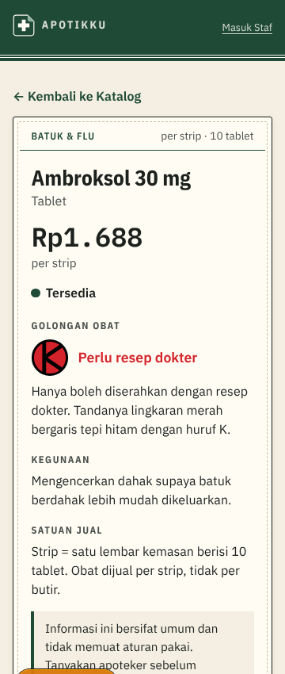
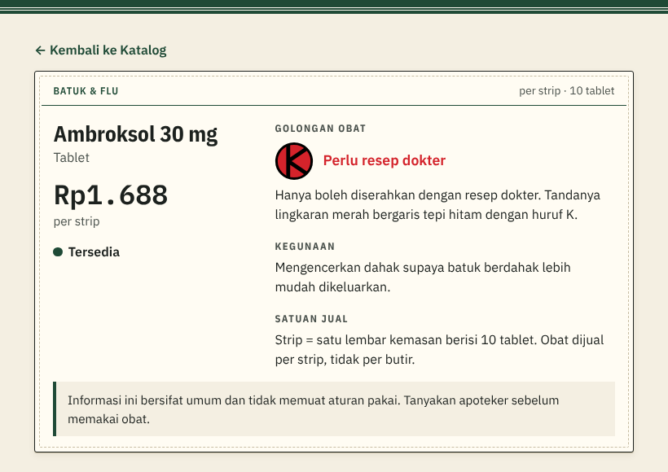
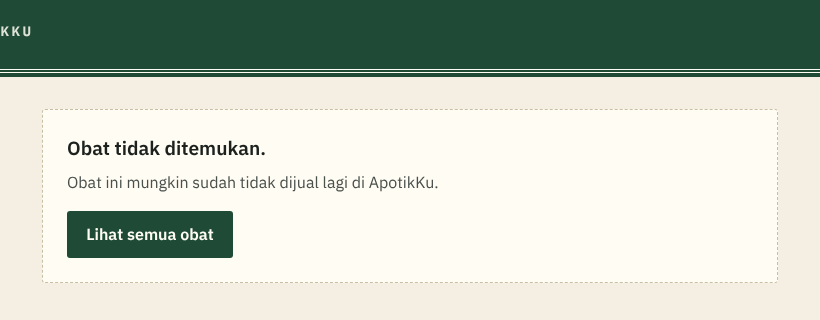

# Penjelasan kode: Detail obat dan tombol WhatsApp (tiket #5)

> Dokumen ini menjelaskan kode tiket #5 untuk orang yang belum pernah membuat aplikasi web. Istilah domain (Katalog, Golongan obat, Satuan jual, Status stok) mengikuti [`CONTEXT.md`](../../CONTEXT.md). Istilah teknis lain ada di kamus [`KENAPA.md`](../KENAPA.md#kamus-istilah-teknis). Keputusan lengkapnya ada di [SPEC 4.2](../SPEC.md#42-alamat-halaman-route) dan [SPEC 4.7](../SPEC.md#47-katalog-dari-prototipe).

## 1. Masalah yang diselesaikan

Kartu di Katalog sengaja ringkas: nama, golongan, Status stok, harga. Itu cukup untuk memilih, tetapi tidak cukup untuk memutuskan. Dua pertanyaan yang sering muncul tidak terjawab di kartu:

- **"Rp1.688 itu per butir atau per strip?"** Banyak orang mengira harga di apotek adalah harga per butir, padahal ApotikKu menjual per Satuan jual (aturan bisnis 4).
- **"Lingkaran merah huruf K itu artinya apa?"** Ini masalah M-06 di PRD: banyak orang belum memperhatikan logo golongan obat.

Tiket ini menambah halaman Detail obat yang menjawab keduanya, dan tombol WhatsApp untuk pertanyaan yang tidak bisa dijawab halaman mana pun. Dua baris Matriks Keterunutan ikut berubah: F-03 dari "Sebagian" dan F-04 dari "Direncanakan" menjadi selesai.

## 2. Kenapa halaman sendiri, bukan jendela di atas Katalog

Di prototipe, detail obat muncul sebagai jendela yang menimpa Katalog. Untuk aplikasi sungguhan kami memilih **alamat sendiri**, yaitu `/obat/ambroksol-30-mg`. Dua alasannya praktis:

- **Tombol Kembali di HP bekerja wajar.** Dengan jendela, tombol Kembali akan menutup seluruh Katalog, bukan menutup jendelanya. Pengunjung merasa "terlempar keluar".
- **Tautannya bisa dibagikan.** Alamat ini bisa dikirim lewat WhatsApp ke keluarga: "ini obatnya, harganya segini". Jendela tidak punya alamat untuk dibagikan.

> **Slug** = versi nama obat yang aman untuk alamat web, misalnya `ambroksol-30-mg`. Dibuat otomatis dari nama saat obat ditambahkan dan tidak ikut berubah saat namanya diubah, supaya tautan yang sudah dibagikan tetap jalan.

Supaya tautan yang dibagikan terlihat masuk akal, **judul halaman memuat nama obatnya**: "Ambroksol 30 mg · ApotikKu". Judul inilah yang muncul sebagai teks pratinjau di aplikasi pesan.

## 3. Isi halaman

Di HP semuanya satu kolom; mulai lebar 46 rem (±736 px) isinya terbagi dua kolom, sesuai rancangan layar di SKPL:

| Kolom | Isi |
|---|---|
| Kiri | Nama obat, Bentuk, harga besar berhuruf monospace, "per strip", Status stok |
| Kanan | Golongan obat (tanda besar + nama + **penjelasan**), Kegunaan, Satuan jual |

Tiga keterangan yang tidak ada di kartu Katalog:

1. **Penjelasan golongan.** Misalnya untuk Obat keras: "Hanya boleh diserahkan dengan resep dokter. Tandanya lingkaran merah bergaris tepi hitam dengan huruf K." Tanda golongannya juga digambar lebih besar (48 px) daripada di kartu. Jadi setiap kali Pengunjung membuka detail, ia ikut belajar membaca logo golongan (M-06).
2. **Penjelasan Satuan jual.** Untuk strip: "Strip = satu lembar kemasan berisi 10 tablet. Obat dijual per strip, tidak per butir." Untuk botol, tube, dan sachet dipakai kalimat sejenis.
3. **Catatan informasi umum** (aturan bisnis 8): "Informasi ini bersifat umum dan tidak memuat aturan pakai. Tanyakan apoteker sebelum memakai obat." Kegunaan sengaja ditulis singkat **tanpa dosis**, karena menyebut dosis di aplikasi sama dengan memberi saran medis.

## 4. Tombol WhatsApp

Tombolnya membuka percakapan dengan pesan awal yang sudah terisi:

> Halo ApotikKu, saya mau tanya tentang Ambroksol 30 mg.

Pengunjung tinggal menekan kirim. Nomornya juga ditulis sebagai **teks biasa di bawah tombol**, supaya bisa disalin kalau tombolnya tidak bekerja (misalnya WhatsApp belum terpasang di laptop).

Nomor apotek dibaca dari **variabel lingkungan** `NEXT_PUBLIC_WHATSAPP_APOTEK` (dikerjakan di tiket #4), bukan ditulis di kode, supaya bisa diganti lewat pengaturan Vercel tanpa mengubah program. Bila belum diisi, dipakai nomor contoh dan di sebelahnya tertulis "(nomor contoh)".

> **Variabel lingkungan** = pengaturan yang dibaca aplikasi saat berjalan, disimpan di luar kode. *Analogi:* PIN brankas yang dihafal penjaga, bukan ditulis di pintu brankas.

## 5. Obat yang tidak ada atau sudah diarsipkan

Halaman ini membaca **tampilan `katalog`**, bukan tabel `obat`. Tampilan itu hanya memuat obat yang **tidak diarsipkan**, dan tidak memuat stok, harga acuan, maupun tanggal kedaluwarsa.

Akibatnya dua hal terjadi sendirinya, tanpa kode tambahan:

- Obat yang diarsipkan Admin **otomatis** menghilang dari Detail obat, sama seperti dari Katalog. Tautan lama yang sudah terlanjur dibagikan akan menampilkan "Obat tidak ditemukan".
- Angka yang bukan urusan Pengunjung tidak mungkin bocor ke halaman ini, karena memang tidak ikut dikirim.

Slug yang tidak ada dan obat yang diarsipkan menampilkan halaman yang **sama persis**. Ini disengaja: orang luar tidak bisa menebak-nebak obat apa yang pernah dijual ApotikKu. Polanya sama dengan halaman Struk di tiket #10.

## 6. Kartu Katalog jadi bisa diketuk

Sebelumnya kartu di Katalog hanya tampilan. Sekarang seluruh kartu bisa diketuk untuk membuka detailnya, tetapi **yang benar-benar menjadi tautan hanyalah nama obatnya**. Seluruh kartu ikut bisa diketuk lewat lapisan tak terlihat (`.tautan::after`) yang menutupi kartu.

Kenapa tidak membungkus seluruh kartu menjadi satu tautan besar? Karena kalau begitu, pembaca layar dan daftar tautan browser akan membaca seluruh isi kartu sebagai nama tautan: "Batuk & Flu per strip 10 tablet Ambroksol 30 mg Tablet Perlu resep dokter Tersedia Rp1.688". Dengan cara ini yang terbaca cukup "Ambroksol 30 mg", sementara jari tetap bisa mengetuk di mana saja.

Tanda fokus keyboard sengaja dipindah ke **seluruh kartu**, bukan hanya sebaris nama, supaya jelas terlihat kartu mana yang sedang dipilih.

## 7. Papan nama dipakai bersama

Tiket ini juga memindahkan papan nama hijau (logo ApotikKu + tautan "Masuk Staf") dari halaman Katalog ke komponen tersendiri, `components/PapanNama.tsx`, lalu dipakai oleh kedua halaman.

Alasannya: Pengunjung yang membuka tautan Detail obat **langsung dari WhatsApp** tidak melewati Katalog sama sekali. Tanpa papan nama, ia mendarat di halaman yang tidak menunjukkan ini apotek apa. Logo dan namanya juga menjadi tautan pulang ke Katalog.

Satu hal kecil yang perlu dijaga: papan nama **tidak** menampilkan judul besar di halaman Detail obat. Setiap halaman web sebaiknya hanya punya satu judul utama (`h1`), dan di halaman ini judul utamanya adalah nama obat.

## 8. Tanpa tes otomatis, seperti #4

Tiket ini tidak menambah tes otomatis, dengan alasan yang sama seperti tiket #4: SPEC 5.1 menetapkan database sebagai satu-satunya titik uji otomatis, dan tiket ini tidak mengubah database sama sekali. Aturan yang benar-benar menjaga data sudah diuji di tempat lain, yaitu tes yang memastikan obat diarsipkan tidak muncul di tampilan `katalog` dan kolom rahasia tidak ikut terkirim (`tests/katalog.test.ts`, sejak tiket #2).

## Kalau dosen bertanya…

**"Kenapa detail obat punya alamat sendiri, bukan jendela seperti di prototipe?"**
Supaya tombol Kembali di HP bekerja wajar dan tautannya bisa dikirim lewat WhatsApp. Prototipe dibuat untuk menjawab pertanyaan tata letak, bukan untuk menentukan alamat halaman.

**"Dari mana penjelasan golongan obat itu?"**
Dari penandaan resmi BPOM yang juga menjadi dasar tanda golongan di kartu (PRD sumber [7] dan [8]). Kami menuliskannya ulang dalam bahasa sehari-hari, karena target penggunanya masyarakat umum, bukan tenaga kesehatan.

**"Kenapa kegunaan obat tidak disertai dosis?"**
Karena menyebut dosis sama dengan memberi saran medis, dan itu bukan wewenang aplikasi katalog. Aturan bisnis 8 menetapkan kegunaan ditulis singkat dan umum, selalu disertai catatan untuk bertanya kepada apoteker.

**"Kalau obat diarsipkan, tautan yang sudah dibagikan jadi rusak dong?"**
Halamannya tetap terbuka, tetapi menampilkan "Obat tidak ditemukan" beserta tautan kembali ke Katalog. Itu memang yang kami inginkan: obat yang tidak lagi dijual tidak boleh terlihat seolah masih ada. Pesannya sama dengan slug yang memang tidak pernah ada, supaya orang luar tidak bisa menebak obat apa saja yang pernah dijual.

**"Kenapa seluruh kartu bisa diketuk tetapi yang jadi tautan cuma namanya?"**
Supaya jari gampang (sasaran ketuk selebar kartu), sementara pembaca layar tetap membaca "Ambroksol 30 mg", bukan seluruh isi kartu. Keduanya dapat yang terbaik.
