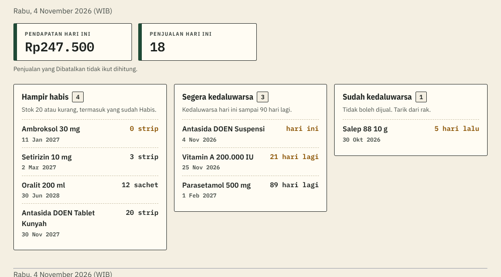
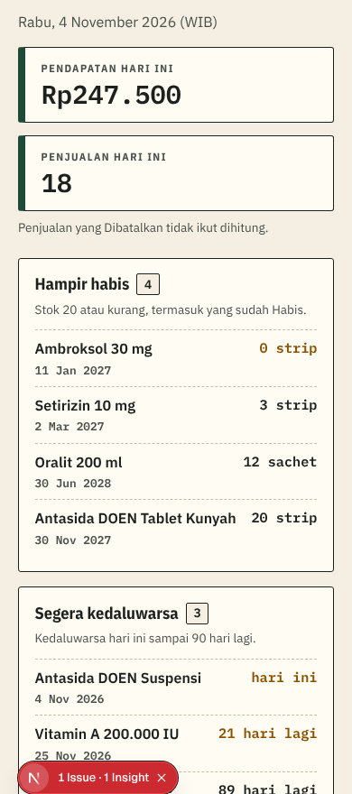

# Penjelasan kode: Ringkasan (tiket #11)

> Dokumen ini menjelaskan kode tiket #11 untuk orang yang belum pernah membuat aplikasi web. Istilah domain (Status stok, Segera kedaluwarsa, Penjualan, Dibatalkan) mengikuti [`CONTEXT.md`](../../CONTEXT.md). Istilah teknis lain ada di kamus [`KENAPA.md`](../KENAPA.md#kamus-istilah-teknis). Keputusan lengkapnya ada di [SPEC 4.4](../SPEC.md#44-fungsi-database).

## 1. Masalah yang diselesaikan

Dua masalah dari PRD bertemu di halaman ini:

- **M-02**: apotek sering terlambat tahu stok hampir habis atau obat mendekati kedaluwarsa. Akibatnya obat kosong saat dicari pembeli, atau obat kedaluwarsa masih tersimpan di rak.
- **Kelemahan versi 1** (PRD bagian 3.2, poin 5): ApotikKu lama punya halaman Dashboard, tetapi **angkanya selalu 0** karena tidak pernah benar-benar dihitung.

Halaman ini adalah halaman pertama yang dibuka Admin setelah masuk. Karena itu isinya bukan "semua data", melainkan **hal yang perlu ditindaklanjuti hari ini**: uang yang masuk, obat yang perlu dipesan ulang, dan obat yang perlu ditarik dari rak.

Sebelum tiket ini, halaman tersebut masih kerangka kosong bertuliskan "Dibangun di tiket #11". Jadi setiap Admin yang masuk langsung disambut halaman kosong.

## 2. Isi halaman

**Dua kotak angka** di atas: Pendapatan hari ini dan Penjualan hari ini. Di bawahnya ada keterangan kecil "Penjualan yang Dibatalkan tidak ikut dihitung", supaya Admin yang baru saja membatalkan sebuah Penjualan tidak menyangka angkanya salah.

**Tiga panel** di bawahnya, masing-masing dengan jumlah obatnya di sebelah judul:

| Panel | Isinya | Yang perlu dilakukan |
|---|---|---|
| **Hampir habis** | Stok 20 atau kurang, termasuk yang sudah Habis | Pesan ulang ke supplier |
| **Segera kedaluwarsa** | Kedaluwarsa hari ini sampai 90 hari lagi | Jual lebih dulu, atau siapkan penggantinya |
| **Sudah kedaluwarsa** | Kedaluwarsa sebelum hari ini | Tarik dari rak; obatnya memang sudah ditolak kasir |

Setiap baris memuat nama obat, angka yang penting (sisa stok, atau sisa hari menuju kedaluwarsa), dan tanggal kedaluwarsanya.

Baris yang **paling mendesak** ditulis dengan warna peringatan cokelat tua: stok 0, kedaluwarsa 30 hari lagi atau kurang, dan semua yang sudah kedaluwarsa. Warnanya sengaja bukan merah, karena di ApotikKu merah khusus untuk tanda Obat keras (ADR 0004).

Panel yang kosong tidak dibiarkan kosong begitu saja, melainkan menulis kalimat yang jelas, misalnya "Tidak ada obat yang hampir habis." Itu kabar baik, dan Admin tidak perlu menebak apakah halamannya gagal dimuat.

## 3. Satu panggilan, bukan empat

Halaman ini butuh empat hal sekaligus: pendapatan, jumlah Penjualan, dan tiga daftar obat. Semuanya diambil lewat **satu** fungsi database, `ringkasan()`.

*Analogi:* seperti memesan paket makanan lengkap dalam satu kali pesan, bukan memesan nasi, lauk, sayur, dan minum satu per satu ke dapur yang sama.

Kenapa penting? Setiap pertanyaan ke database harus menyeberang ke Singapura dan kembali. Empat pertanyaan berarti empat kali waktu tunggu. Dengan satu panggilan, halaman tampil jauh lebih cepat, dan "hari ini" pasti dihitung dari satu waktu yang sama untuk keempat bagiannya.

## 4. Aturan tanggal tetap di database

Ini keputusan yang paling mudah salah kalau tidak hati-hati.

Fungsi `ringkasan()` memakai `private.hari_ini()` dan `private.sudah_kedaluwarsa()`, **fungsi yang sama** dengan Katalog, layar Jual, dan Penjualan hari ini. Jadi arti "hari ini menurut WIB" hanya ditulis sekali, dan tidak mungkin berbeda antar halaman.

Fungsi ini juga ikut menghitung **sisa hari** menuju kedaluwarsa (`sisa_hari`) dan sudah lewat berapa hari (`lewat_hari`), lalu mengirimkannya ke layar. Layar tinggal menuliskannya: 0 → "hari ini", 1 → "besok", 12 → "12 hari lagi".

**Kenapa tidak dihitung di browser saja?** Karena selisih tanggal di browser dihitung memakai **jam komputer Admin**. Kalau jam laptopnya meleset, atau zona waktunya disetel bukan WIB, angka "tinggal 3 hari" bisa jadi salah sehari. Padahal yang dipakai aplikasi adalah kalender WIB. Database sudah tahu tanggal berapa sekarang menurut WIB, jadi biarkan database yang menghitung.

## 5. Hanya Admin, dijaga database

Kasir tidak boleh melihat Ringkasan. Alasannya sama dengan Laporan: pendapatan harian adalah wewenang Admin (ADR 0003).

Penjagaannya berlapis, dan lapisan yang benar-benar menentukan ada di database:

| Lapisan | Yang dilakukan | Bisa dilewati? |
|---|---|---|
| Menu | Menu "Ringkasan" tidak muncul untuk Kasir | Ya, tinggal mengetik alamatnya |
| Halaman | `wajibAdmin()` memindahkan Kasir ke layar Jual | Ya, kalau ada bug di kode halaman |
| **Fungsi database** | `ringkasan()` menolak siapa pun yang bukan Admin aktif | **Tidak** |

Kalau Kasir memanggil fungsinya langsung lewat DevTools browser, database menjawab: "Hanya Admin yang bisa melihat Ringkasan." Pengunjung yang belum login bahkan ditolak di pintu, karena izin menjalankan fungsi ini memang tidak diberikan kepada akun anonim. Keduanya ada tesnya.

> **Security definer** = fungsi database yang berjalan dengan hak pemiliknya, bukan hak pemanggil. *Analogi:* petugas gudang yang boleh masuk gudang atas nama pembeli, tetapi hanya mengambilkan barang yang memang boleh diambil pembeli itu. Karena itu fungsinya **wajib** mengecek sendiri siapa pemanggilnya, dan itulah yang dilakukan baris pertama `ringkasan()`.

## 6. Tes otomatis yang tahan berjalan bersamaan

Tes untuk tiket ini punya satu kesulitan yang tidak dimiliki tiket sebelumnya.

File tes di project ini berjalan **bersamaan**. Sementara `tests/ringkasan.test.ts` berjalan, `penjualan.test.ts` dan `pembatalan.test.ts` terus mencatat Penjualan baru hari ini. Artinya angka "pendapatan hari ini" **berubah terus** selama tes berjalan, jadi tidak bisa dibandingkan dengan angka tetap.

Percobaan pertama kami adalah menguji **selisihnya**: catat pendapatan, jual Rp6.000, lalu pastikan pendapatannya naik minimal Rp6.000. Cara itu **gagal di CI**, dan kegagalannya mengajarkan sesuatu: tes lain bukan hanya *menambah* Penjualan, tetapi juga *membatalkan* Penjualan. Jadi angka pendapatan bisa naik **dan turun** sendiri selama tes berjalan, sehingga tidak ada arah selisih yang aman.

Jalan keluarnya: **bandingkan dengan hitungan sendiri**.

1. Jumlahkan sendiri Penjualan hari ini langsung dari tabel.
2. Panggil `ringkasan()`.
3. Jumlahkan lagi dari tabel.
4. Kalau hasil langkah 1 dan 3 **sama persis**, berarti tidak ada tes lain yang menyelipkan perubahan di tengah, dan angka dari `ringkasan()` boleh dibandingkan dengan tepat. Kalau berbeda, ulangi (sampai 6 kali).

Lalu diperiksa tiga hal sekaligus: pendapatan sama dengan jumlah Penjualan berstatus selesai, sama dengan (semua Penjualan − yang Dibatalkan), dan jumlah Penjualannya cocok. Tes ini sengaja membatalkan satu Penjualan lebih dulu, supaya pemeriksaan "Dibatalkan tidak dihitung" benar-benar ada isinya.

*Analogi:* seperti menghitung uang di laci saat kasir masih melayani pembeli. Daripada menebak dari selisih, kita menunggu satu jeda singkat ketika tidak ada transaksi, lalu menghitung dan mencocokkan.

Ada satu jebakan yang kami temukan justru **setelah** tesnya dijalankan di CI. Mula-mula tes ini menjual obat milik tes Pembatalan. Hasilnya `pembatalan.test.ts` gagal: ia menyetel stok obat itu ke 100, menjual 2, lalu memastikan stoknya tepat 98 — padahal tes Ringkasan diam-diam menjual 2 lagi, jadi angkanya 96. Perbaikannya: tes Ringkasan memakai obat **miliknya sendiri**, `Uji Jual Ringkasan`, dengan stok sangat besar. Aturannya jadi jelas untuk tiket berikutnya: *setiap file tes yang mengubah stok harus punya obat sendiri.*

Daftar obatnya lain cerita: itu bisa diuji **tepat**, karena memakai obat uji yang tidak boleh diubah tes lain (`uji_atur_obat` hanya mengizinkan obat ber-slug `uji-jual-*`). Untuk menguji batas 90 hari dari dua sisi, data uji ditambah dua obat baru: `Uji Kedaluwarsa 90 Hari` (harus muncul) dan `Uji Kedaluwarsa 91 Hari` (tidak boleh muncul). Tanggal keduanya disegarkan jadwal pg_cron setiap menit, sama seperti baris "kemarin" dan "hari ini", supaya tesnya tetap benar kapan pun dijalankan.

## 7. Yang sengaja belum dikerjakan

Kriteria di issue #11 menyebut setiap baris punya **tautan ke halaman ubah obat**. Itu belum dipasang, dan sengaja.

Halaman `/staf/obat/[id]` baru dibuat di tiket #9. Kalau tautannya dipasang sekarang, Admin yang mengetuknya akan mendarat di halaman yang belum ada. Nomor (`id`) setiap obat sudah ikut dikirim fungsi database, jadi saat #9 selesai, tautannya tinggal dipasang tanpa mengubah database lagi.

## Kalau dosen bertanya…

**"Kenapa daftar Hampir habis juga memuat obat yang stoknya 0, padahal namanya 'hampir habis'?"**
Karena yang dibutuhkan Admin adalah daftar "perlu dipesan ulang", dan obat yang sudah habis justru paling mendesak. Supaya tidak membingungkan, judul panelnya diberi keterangan "Stok 20 atau kurang, termasuk yang sudah Habis". Istilah Status stok di CONTEXT.md tetap tidak berubah artinya.

**"Kenapa sisa hari dihitung di database, bukan di aplikasi?"**
Karena selisih tanggal di browser dihitung memakai jam komputer Admin. Kalau jamnya meleset atau zona waktunya bukan WIB, angkanya bisa salah sehari. Database sudah memegang kalender WIB untuk seluruh aplikasi, jadi perhitungannya cukup di satu tempat.

**"Kenapa Kasir tidak boleh melihat Ringkasan?"**
Karena di dalamnya ada pendapatan harian, dan itu wewenang Admin (ADR 0003). Bukan sekadar menyembunyikan menu: fungsi databasenya sendiri menolak Kasir, dan itu diuji otomatis.

**"Bagaimana memastikan angka pendapatannya benar, kalau tesnya cuma memeriksa selisih?"**
Karena file tes berjalan bersamaan, angka totalnya memang terus berubah. Yang kami uji adalah hubungan sebab-akibatnya: mencatat Penjualan menaikkan pendapatan sebesar nilai Penjualan itu, dan membatalkannya menurunkan kembali. Itu justru yang ingin dibuktikan, dan hasilnya tidak bergantung pada data lain.

**"Kenapa Dashboard versi 1 angkanya selalu 0, dan kenapa sekarang tidak?"**
Versi 1 menyimpan data hanya di browser dan tidak pernah benar-benar menjumlahkan Penjualan. Sekarang Penjualan tersimpan di database, dan angkanya dijumlahkan oleh database itu sendiri dengan aturan yang diuji otomatis.
