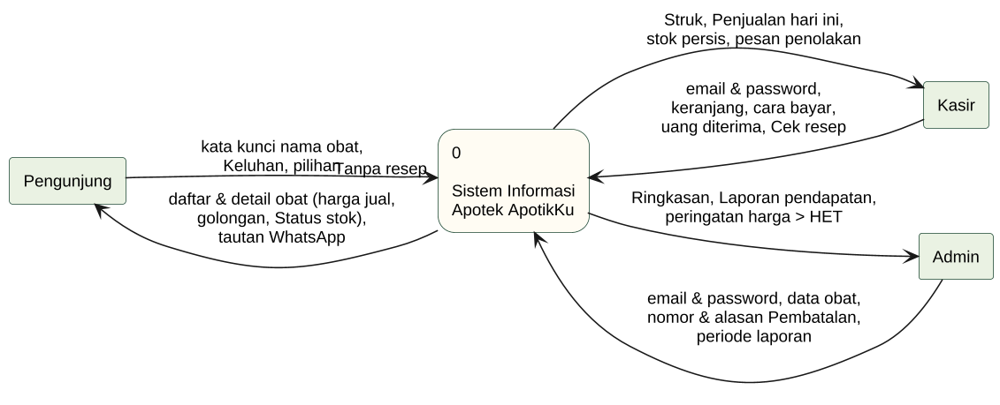
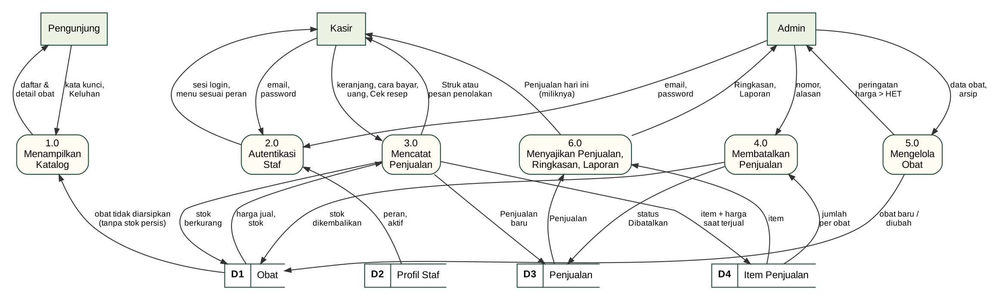
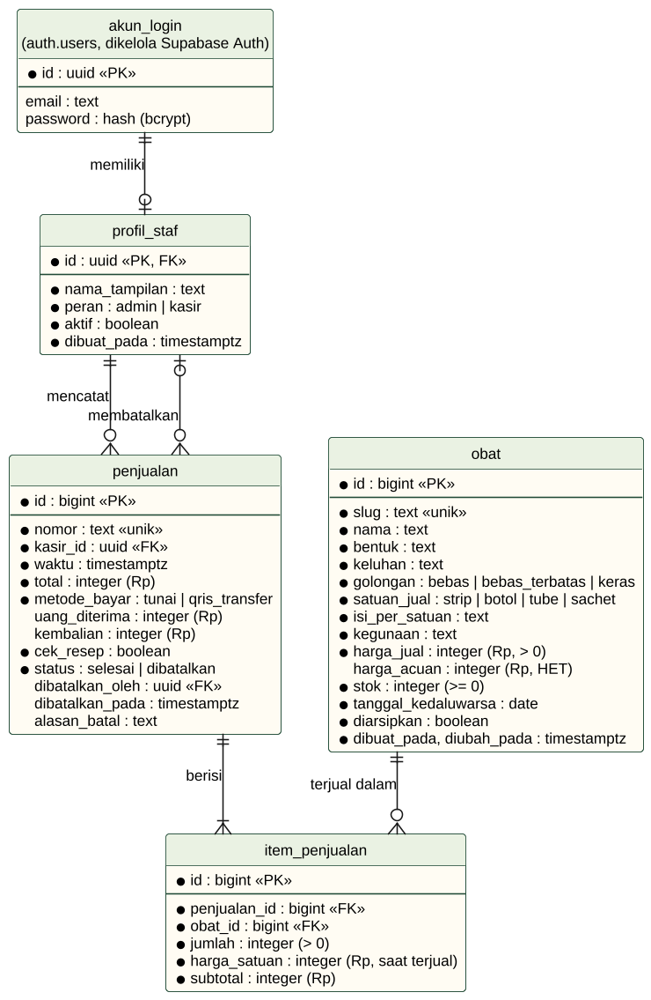
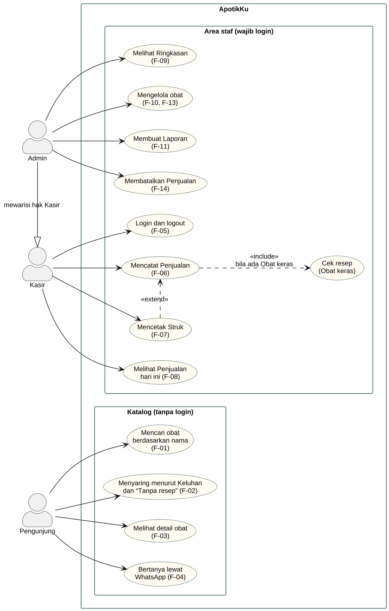
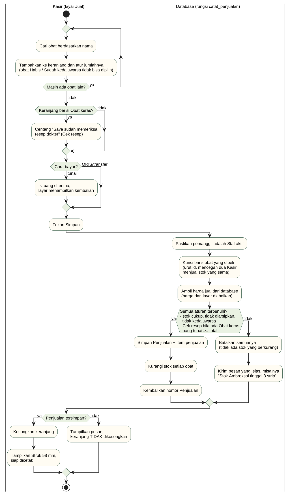

# Analisis Perangkat Lunak: Requirement Gathering dan SKPL ApotikKu

> Bahan tugas Sesi 4 mata kuliah Rekayasa Perangkat Lunak (TI25B). Versi di repo ini sengaja **tanpa nama dan NIM**; PDF yang memuat identitas kelompok dibuat di luar repo memakai format tugas dosen.
> Versi yang dikumpulkan (revisi 18 Okt 2026) diisi langsung ke file template `SKPL.docx` dari dosen: judul bab mengikuti template, hasil *requirement gathering* menjadi Lampiran A, dan sampulnya memakai logo ApotikKu (#33).
> Isi dokumen ini disusun ulang dari [`PRD.md`](../PRD.md) dan [`SPEC.md`](../SPEC.md) mengikuti template SKPL dari dosen (adaptasi IEEE Std 830-1993, ancangan berorientasi proses). Sumber diagram ada di [`gambar/sesi-04/`](gambar/sesi-04/).

## Soal

1. Lakukan *requirement gathering* (fitur, *user role*, target pengguna).
2. Buat dokumen Spesifikasi Kebutuhan Perangkat Lunak (SKPL) mengikuti template yang diberikan.
3. Gambar *use case diagram* / *flowchart*.
4. Dikumpulkan dalam bentuk PDF, paling lambat H-1 pertemuan berikutnya.

## Jawaban

### Pengantar

Pada Sesi 3 kelompok kami menetapkan tema **Sistem Informasi Apotek "ApotikKu"** beserta masalah dan fitur utamanya. Sesi 4 berada di tahap **analisis perangkat lunak**: kebutuhan yang sudah ditemukan dirinci sampai cukup jelas untuk dirancang dan diuji. Hasilnya dibakukan dalam SKPL, yaitu dokumen yang menjadi "kontrak" antara pengguna dan pengembang tentang apa yang harus bisa dilakukan sistem.

Prinsip kelompok tetap sama: **bukan kita yang butuh teknologi, tetapi teknologi yang butuh kita.** Setiap kebutuhan di dokumen ini bisa ditelusuri ke masalah nyata, dan setiap kebutuhan punya cara untuk menguji apakah sudah terpenuhi (lihat Matriks Keterunutan di bagian 2.4).

---

## 1. Requirement Gathering

### 1.1 Metode pengumpulan kebutuhan

| No | Metode | Yang dilakukan | Hasil |
|---|---|---|---|
| 1 | **Studi pustaka** | Membaca jurnal, artikel, dan sumber resmi (BPOM, Kemenkes, dinas kesehatan) tentang pengelolaan apotek di Indonesia | Tujuh masalah M-01 s.d. M-07 beserta sumbernya [1]–[8] |
| 2 | **Analisis sistem lama** | Memeriksa kode ApotikKu versi 1 (HTML + Bootstrap + JavaScript, data di browser) | Sepuluh kelemahan yang harus diperbaiki |
| 3 | **Prototipe tampilan** | Membuat tiga tata letak Katalog di HP (tumpukan etiket, lemari keluhan, papan daftar harga) lalu membandingkan cara Pengunjung menemukan obat | Tata letak terpilih: kartu etiket + laci Keluhan; harga ditemukan ≤ 2 langkah |
| 4 | **Penurunan kebutuhan** | Setiap masalah diturunkan menjadi kebutuhan fungsional dan non-fungsional yang terukur | 14 kebutuhan fungsional (F-01 s.d. F-14) dan 7 non-fungsional (NF-01 s.d. NF-07) |

Wawancara langsung dengan apotek tidak dilakukan. Masalah dari studi pustaka diperlakukan sebagai **asumsi** yang akan dibuktikan ulang pada tahap pengujian dengan anggota kelompok berperan sebagai pengguna (lihat 2.2.5).

### 1.2 Masalah yang ditemukan

| Kode | Masalah | Sumber |
|---|---|---|
| M-01 | Pencatatan stok manual rawan salah catat, data hilang, dan tidak sesuai dengan isi rak | [1], [2] |
| M-02 | Apotek terlambat tahu stok hampir habis atau obat mendekati kedaluwarsa | [1], [3] |
| M-03 | Penjualan di kasir lama dan menimbulkan antrean, terutama saat pembeli membeli beberapa obat | [4], [5] |
| M-04 | Laporan penjualan disusun manual, lambat dan rawan salah hitung | [2], [4] |
| M-05 | Harga obat generik kadang dijual melebihi Harga Eceran Tertinggi (HET) | [6] |
| M-06 | Banyak masyarakat belum memperhatikan logo golongan obat (hijau, biru, merah K) | [7], [8] |
| M-07 | Untuk tahu obat tersedia dan berapa harganya, pembeli harus datang atau bertanya langsung | Asumsi kelompok |

Kelemahan ApotikKu versi 1 yang ditemukan: data hanya tersimpan di browser, hanya halaman Dashboard yang mengecek login, tombol Logout tidak benar-benar mengakhiri sesi, password disimpan apa adanya, angka Dashboard selalu 0, pilihan jenis laporan tidak berfungsi, satu transaksi hanya untuk satu obat, hanya ada satu jenis pengguna, dan belum ada data kedaluwarsa.

### 1.3 Target pengguna

| Target | Gambaran | Perangkat dan situasi pemakaian |
|---|---|---|
| Masyarakat sekitar apotek | Orang yang ingin tahu obat ada atau tidak, harganya, dan perlu resep atau tidak, sebelum datang | HP, koneksi 4G, layar mulai 360 px, sering terburu-buru |
| Kasir apotek | Staf yang melayani pembeli di meja kasir | Laptop atau tablet di meja kasir, printer struk 58 mm, harus cepat saat antre |
| Pemilik / apoteker penanggung jawab | Orang yang menentukan harga, memantau stok, dan menerima laporan pendapatan | Laptop, biasanya di luar jam ramai |

Cakupan produk adalah **satu apotek** bernama ApotikKu, bukan platform banyak apotek.

### 1.4 Peran pengguna (*user role*)

| Peran | Login? | Hak akses utama |
|---|:-:|---|
| **Pengunjung** | Tidak | Membaca Katalog: nama, harga jual, golongan, Status stok. Tidak bisa melihat jumlah stok persis atau harga acuan, dan tidak bisa mengubah apa pun |
| **Kasir** | Ya | Semua hak Pengunjung, ditambah melihat stok persis, mencatat Penjualan, mencetak Struk, dan melihat Penjualan miliknya hari ini |
| **Admin** | Ya | Semua hak Kasir, ditambah mengelola obat dan harga, melihat Ringkasan dan Laporan pendapatan, melihat Penjualan semua Kasir, dan membatalkan Penjualan |

| Aksi | Pengunjung | Kasir | Admin |
|---|:-:|:-:|:-:|
| Melihat Katalog | Ya | Ya | Ya |
| Melihat jumlah stok persis dan harga acuan | Tidak | Ya | Ya |
| Mencatat Penjualan dan mencetak Struk | Tidak | Ya | Ya |
| Menambah, mengubah, mengarsipkan obat | Tidak | Tidak | Ya |
| Melihat Ringkasan dan Laporan pendapatan | Tidak | Tidak | Ya |
| Membatalkan Penjualan | Tidak | Tidak | Ya |

Kasir sengaja **tidak** bisa membatalkan Penjualan: bila bisa, Kasir dapat menerima uang lalu membatalkan Penjualannya sehingga uang tidak tercatat (pemisahan tugas).

### 1.5 Fitur

| Kelompok | Kode | Fitur |
|---|---|---|
| Katalog | F-01 | Mencari obat berdasarkan nama |
| | F-02 | Menyaring obat berdasarkan Keluhan dan pilihan "Tanpa resep" |
| | F-03 | Menampilkan detail obat: nama, Bentuk, harga jual, golongan dalam bahasa sederhana, kegunaan umum, Status stok |
| | F-04 | Menghubungkan Pengunjung ke WhatsApp apotek |
| Area staf | F-05 | Login dan logout Staf; menolak akses Area staf tanpa login |
| | F-06 | Mencatat Penjualan berisi banyak obat, menghitung total dan kembalian, meminta Cek resep untuk Obat keras |
| | F-07 | Mencetak Struk 58 mm |
| | F-08 | Menampilkan Penjualan hari ini |
| | F-09 | Menampilkan Ringkasan: pendapatan hari ini, obat Hampir habis, Segera kedaluwarsa, Sudah kedaluwarsa |
| | F-10 | Menambah, mengubah, dan mengarsipkan obat |
| | F-11 | Membuat dan mencetak Laporan pendapatan per periode |
| | F-12 | Menghitung Status stok otomatis dan menolak penjualan obat Habis atau Sudah kedaluwarsa |
| | F-13 | Memberi peringatan bila harga jual melebihi HET |
| | F-14 | Membatalkan Penjualan: stok kembali, Penjualan tetap tercatat sebagai Dibatalkan |

---

## 2. Spesifikasi Kebutuhan Perangkat Lunak (SKPL) ApotikKu

| Nama aplikasi | Nomor dokumen | Revisi | Tanggal |
|---|---|---|---|
| ApotikKu | SKPL-APOTIKKU-01 | A | 13 Oktober 2026 |

**Daftar perubahan**

| Revisi | Deskripsi |
|---|---|
| A | Versi pertama SKPL ApotikKu versi 1, disusun dari hasil analisis kebutuhan Sesi 3 |

### 2.1 Pendahuluan

#### 2.1.1 Tujuan

Dokumen ini menjelaskan kebutuhan perangkat lunak ApotikKu versi 1 secara lengkap dan terukur. Pembacanya:

| Pembaca | Tujuan membaca |
|---|---|
| Pengembang (anggota kelompok) | Acuan merancang database, halaman, dan aturan hak akses |
| Penguji | Acuan menyusun kasus uji untuk setiap kebutuhan (lihat Matriks Keterunutan) |
| Dosen pengampu | Menilai kelengkapan dan ketertelusuran analisis kebutuhan |
| Pemilik apotek (pengguna) | Memastikan sistem menjawab masalah apoteknya |

#### 2.1.2 Lingkup masalah

Perangkat lunak yang dispesifikasikan adalah **ApotikKu versi 1**, aplikasi web untuk satu apotek dengan dua sisi:

1. **Katalog** (publik, tanpa login): Pengunjung mencari obat lewat nama atau laci Keluhan, melihat harga jual, golongan obat dalam bahasa sederhana, dan Status stok, lalu bisa bertanya lewat WhatsApp.
2. **Area staf** (wajib login): Kasir mencatat Penjualan berisi banyak obat dan mencetak Struk; Admin juga mengelola obat, melihat Ringkasan, membuat Laporan, dan membatalkan Penjualan.

Yang **tidak** dilakukan sistem: pemesanan atau pembayaran online oleh Pengunjung, pembayaran QRIS yang tersambung ke bank (hanya dicatat), penjualan eceran per butir, penyimpanan data resep atau pasien, platform banyak apotek, dan fitur AI.

Manfaat yang dituju: stok di sistem selalu sama dengan rak (M-01), apotek diberi tahu sebelum stok habis atau obat kedaluwarsa (M-02), Penjualan 3 obat selesai ≤ 30 detik (M-03), laporan otomatis (M-04), peringatan HET (M-05), edukasi golongan obat (M-06), dan masyarakat bisa mengecek obat dari rumah (M-07).

Dokumen ini konsisten dengan dokumen pendahulunya: hasil analisis kebutuhan Sesi 3 dan dokumen produk kelompok (PRD).

#### 2.1.3 Definisi, akronim, dan singkatan

| Istilah | Arti |
|---|---|
| SKPL | Spesifikasi Kebutuhan Perangkat Lunak (*Software Requirements Specification*) |
| DFD | *Data Flow Diagram*, diagram aliran data |
| ERD | *Entity Relationship Diagram*, diagram hubungan antar data |
| HET | Harga Eceran Tertinggi obat generik yang ditetapkan Kementerian Kesehatan |
| RLS | *Row Level Security*, aturan di dalam database tentang siapa boleh membaca atau mengubah baris data yang mana |
| WIB | Waktu Indonesia Barat (Asia/Jakarta); semua "hari ini" dihitung dengan zona ini |
| Pengunjung | Siapa pun yang membuka Katalog tanpa login |
| Staf | Orang apotek yang punya akun; selalu berperan sebagai Admin atau Kasir |
| Penjualan | Satu kali pembeli dilayani di kasir, berisi satu atau lebih Item penjualan |
| Item penjualan | Satu baris dalam Penjualan: satu obat, jumlahnya, dan harga jual saat terjual |
| Struk | Bukti cetak sebuah Penjualan untuk pembeli |
| Satuan jual | Satu-satunya satuan tempat obat dijual dan stoknya dihitung (strip, botol, tube, sachet) |
| Keluhan | Kelompok masalah kesehatan yang dibantu obat, misalnya Demam & Nyeri, Batuk & Flu |
| Golongan obat | Penggolongan BPOM: obat bebas (lingkaran hijau), bebas terbatas (lingkaran biru), obat keras (lingkaran merah huruf K) |
| Status stok | Habis (stok 0 atau sudah kedaluwarsa), Hampir habis (1–20), Tersedia (> 20) |
| Cek resep | Konfirmasi Kasir bahwa pembeli membawa resep dokter untuk Obat keras; isi resep tidak disimpan |
| Arsipkan | Menyembunyikan obat dari Katalog dan kasir tanpa menghapus riwayat penjualannya |
| Pembatalan | Tindakan Admin menandai Penjualan sebagai Dibatalkan; stok kembali, Penjualan tetap tercatat |
| Harga acuan | HET obat, hanya terlihat oleh Staf; boleh kosong bila obat tidak punya HET |

#### 2.1.4 Referensi

| Dokumen | Penerbit |
|---|---|
| IEEE Std 830-1993, *IEEE Recommended Practice for Software Requirements Specifications* | IEEE |
| Template SKPL ancangan berorientasi proses (adaptasi Panduan GL01) | Dosen pengampu, Universitas Nusa Putra |
| Tugas Sesi 3: Kebutuhan Perangkat Lunak ApotikKu | Kelompok ApotikKu, TI25B, Oktober 2026 |
| Keputusan Menteri Kesehatan No. 092/MENKES/SK/II/2012 tentang HET Obat Generik | Kementerian Kesehatan RI [9] |
| Sumber studi pustaka [1]–[8] | Lihat Daftar Pustaka |

#### 2.1.5 Deskripsi umum dokumen

Bagian 2.1 menjelaskan dokumen ini. Bagian 2.2 menggambarkan perangkat lunak secara umum: posisinya, fungsi dasarnya, penggunanya, batasan, dan asumsinya. Bagian 2.3 merinci kebutuhan: antarmuka eksternal (dengan diagram konteks/DFD level 0), kebutuhan fungsional (DFD level 1 dan deskripsi proses), deskripsi data (ERD dan kamus data), kebutuhan non-fungsional, atribut kualitas, dan batasan perancangan. Bagian 2.4 berisi Matriks Keterunutan.

Notasi pelengkap di luar DFD dan ERD: **use case diagram** (siapa melakukan apa) dan **flowchart** proses Mencatat Penjualan, keduanya di bagian 3. DFD memakai notasi Gane & Sarson: entitas luar berupa kotak, proses berupa kotak bersudut bulat, penyimpanan data berupa kotak bernomor D1–D4.

### 2.2 Deskripsi Global Perangkat Lunak

#### 2.2.1 Perspektif produk

ApotikKu versi 1 adalah **pengganti** ApotikKu versi 1 berbasis HTML (data di browser). Aplikasi ini berdiri sendiri dan tidak terhubung ke sistem apotek lain, tetapi bergantung pada tiga layanan:

| Komponen | Peran terhadap ApotikKu |
|---|---|
| Browser Pengunjung dan Staf | Menampilkan halaman; Katalog untuk HP, Area staf untuk laptop/tablet |
| Server aplikasi Next.js di Vercel (Singapura) | Menyusun halaman, menjalankan login/logout, meneruskan perintah ke database |
| Supabase: database PostgreSQL + Supabase Auth (Singapura) | Menyimpan data, menyimpan akun Staf dengan password ter-*hash*, dan menegakkan semua aturan hak akses (RLS) serta aturan Penjualan |
| WhatsApp | Tujuan tautan "Tanya lewat WhatsApp"; ApotikKu hanya membuka tautan, tidak mengirim pesan sendiri |
| Printer struk 58 mm | Mencetak Struk lewat fitur cetak browser |

Aliran umumnya: browser → server aplikasi → database. Aturan yang wajib benar (hak akses, stok tidak minus, harga dari database) **tinggal di database**, sehingga tetap berlaku walaupun tampilan memiliki bug atau ada orang yang mencoba mengirim perintah langsung.

#### 2.2.2 Fungsi produk

Fungsi dasar sistem (sama dengan proses pada DFD level 1):

| No | Fungsi dasar | Fitur | Pengguna |
|---|---|---|---|
| 1.0 | Menampilkan Katalog | F-01, F-02, F-03, F-04, F-12 | Pengunjung |
| 2.0 | Autentikasi Staf | F-05 | Kasir, Admin |
| 3.0 | Mencatat Penjualan | F-06, F-07, F-12 | Kasir, Admin |
| 4.0 | Membatalkan Penjualan | F-14 | Admin |
| 5.0 | Mengelola obat | F-10, F-13 | Admin |
| 6.0 | Menyajikan Penjualan, Ringkasan, dan Laporan | F-08, F-09, F-11 | Kasir (Penjualan miliknya), Admin |

Hubungan pengguna dengan fungsi-fungsi ini digambarkan pada use case diagram di bagian 3.1.

#### 2.2.3 Karakteristik pengguna

| Pengguna | Tanggung jawab | Hak akses | Tingkat pendidikan | Keterampilan | Pengalaman | Pelatihan |
|---|---|---|---|---|---|---|
| Pengunjung | Mencari informasi obat sebelum datang ke apotek | Fungsi 1.0 | Bebas | Bisa memakai browser di HP | Tidak diperlukan | Tidak diperlukan |
| Kasir | Melayani pembeli dengan cepat dan benar, mencetak Struk | Fungsi 1.0, 2.0, 3.0, 6.0 (Penjualan miliknya hari ini) | Minimal SMA/SMK | Terbiasa memakai komputer atau tablet | Melayani pembeli | Penjelasan layar Jual ≤ 5 menit (NF-03) |
| Admin | Menetapkan harga, menjaga data obat, memantau stok dan kedaluwarsa, memeriksa pendapatan, membatalkan Penjualan yang salah | Semua fungsi | Pemilik apotek atau apoteker penanggung jawab | Terbiasa memakai komputer | Mengelola apotek | Penjelasan halaman Obat, Ringkasan, dan Laporan |

#### 2.2.4 Batasan-batasan

1. **Kebijakan apotek dan aturan obat**: Obat keras hanya boleh diserahkan dengan resep dokter, sehingga Penjualan berisi Obat keras wajib melalui Cek resep. Kegunaan obat ditulis umum tanpa dosis, disertai catatan "Informasi ini bersifat umum. Tanyakan apoteker sebelum memakai obat."
2. **Riwayat tidak boleh hilang**: obat yang pernah terjual tidak dihapus (diarsipkan); Penjualan tidak dihapus (dibatalkan).
3. **Biaya**: seluruh layanan memakai paket gratis (Rp0 per bulan). Akibatnya, project database dijeda bila ±1 minggu tidak dipakai, dan paket gratis Vercel hanya untuk non-komersial.
4. **Perangkat keras**: tidak ada perangkat khusus; Struk dicetak lewat fitur cetak browser ke printer 58 mm.
5. **Platform**: berjalan di browser modern (Chrome, Edge, Safari, Firefox) di HP, tablet, dan laptop; tidak ada aplikasi Android/iOS terpisah.
6. **Tanpa pendaftaran akun umum**: akun Staf dibuat pengelola lewat dasbor Supabase sampai kelola akun dari aplikasi tersedia (milestone 2).

#### 2.2.5 Asumsi dan kebergantungan

| Asumsi / kebergantungan | Bila berubah |
|---|---|
| Masalah M-01 s.d. M-07 berasal dari studi pustaka, belum dari apotek tertentu | Kebutuhan diuji ulang oleh anggota kelompok sebagai pengguna percobaan; fitur bisa disesuaikan |
| Layanan Supabase dan Vercel tetap tersedia dengan paket gratis | Struktur database tersimpan sebagai file migrasi SQL di repository dan bisa dipasang di PostgreSQL lain; Next.js bisa dijalankan di hosting lain |
| Data HET publik (KMK 092/2012) mungkin bukan versi terbaru | Harga jual tetap bisa diatur Admin; peringatan HET hanya peringatan |
| Pengunjung dan Staf memiliki koneksi internet | Tanpa internet aplikasi tidak bisa dipakai (tidak ada mode luring) |

**Prioritas pengembangan** (bertahap, satu increment = satu tiket yang bisa didemokan): Katalog tampil dari database dan login Staf (sudah selesai), data awal ±40 obat, Mencatat Penjualan, Struk dan Penjualan hari ini, Pembatalan, Kelola obat, Ringkasan, Laporan, pencarian dan laci Keluhan, detail obat dan WhatsApp, lalu uji manual dan rilis.

**Kebutuhan yang ditunda** ke versi berikutnya (milestone 2): stok masuk dari supplier dan data supplier, kedaluwarsa per batch, impor obat dari Excel/CSV, catatan siapa mengubah harga dan stok, kelola akun Staf dari aplikasi, dan foto obat.

### 2.3 Deskripsi Rinci Kebutuhan

#### 2.3.1 Kebutuhan antarmuka eksternal

**Diagram konteks (DFD level 0)**

| Aliran data | Dari → ke | Isi |
|---|---|---|
| Permintaan Katalog | Pengunjung → Sistem | Kata kunci nama obat, Keluhan, pilihan "Tanpa resep" |
| Informasi obat | Sistem → Pengunjung | Daftar dan detail obat (harga jual, golongan, Status stok), tautan WhatsApp |
| Data login | Kasir/Admin → Sistem | Email dan password |
| Data Penjualan | Kasir → Sistem | Keranjang (obat + jumlah), cara bayar, uang diterima, Cek resep |
| Hasil Penjualan | Sistem → Kasir | Struk, Penjualan hari ini, stok persis, pesan penolakan |
| Data pengelolaan | Admin → Sistem | Data obat, nomor dan alasan Pembatalan, periode laporan |
| Informasi pengelolaan | Sistem → Admin | Ringkasan, Laporan pendapatan, peringatan harga > HET |

##### Antarmuka pemakai

| Kode | Kebutuhan | Cara memverifikasi |
|---|---|---|
| UI-01 | Seluruh tulisan memakai bahasa Indonesia sehari-hari tanpa istilah teknis | Inspeksi semua halaman |
| UI-02 | Katalog dirancang untuk HP lebih dulu dan nyaman dibaca di layar 360 px tanpa memperbesar layar | Demonstrasi di layar 360 px |
| UI-03 | Harga satu obat ditemukan Pengunjung dalam ≤ 2 langkah dari halaman utama | Demonstrasi dengan stopwatch |
| UI-04 | Setiap obat menampilkan tanda golongan resmi beserta tulisannya ("Perlu resep dokter" untuk Obat keras); golongan tidak dibedakan dengan warna saja | Inspeksi kartu obat |
| UI-05 | Layar Jual untuk laptop/tablet; Kasir menyelesaikan Penjualan 3 jenis obat dalam ≤ 30 detik | Demonstrasi dengan stopwatch |
| UI-06 | Kasir baru bisa memakai layar Jual setelah ≤ 5 menit penjelasan | Demonstrasi dengan pengguna baru |
| UI-07 | Tindakan berbahaya (Pembatalan, Arsipkan) selalu meminta konfirmasi | Demonstrasi |
| UI-08 | Pesan gagal login selalu "Email atau password salah.", tanpa menyebut mana yang salah | Demonstrasi |
| UI-09 | Pesan penolakan Penjualan menyebut obatnya, misalnya "Stok Ambroksol 30 mg tinggal 3 strip"; keranjang tidak hilang bila gagal | Demonstrasi |
| UI-10 | Menu sesuai peran: Kasir = Jual, Penjualan hari ini; Admin = Ringkasan, Jual, Penjualan hari ini, Obat, Laporan | Demonstrasi |

##### Antarmuka perangkat keras

Tidak ada perangkat keras khusus. Struk dicetak lewat fitur cetak browser dengan pengaturan kertas 58 mm ke printer thermal kasir; Laporan dicetak di kertas A4.

##### Antarmuka perangkat lunak

| Nama | Versi | Sumber | Tujuan |
|---|---|---|---|
| Supabase Database (PostgreSQL) | Layanan terkelola, region Singapura | supabase.com | Menyimpan data obat, profil Staf, Penjualan; menjalankan fungsi database dan RLS |
| Supabase Auth | Layanan terkelola | supabase.com | Login email + password, menyimpan password ter-*hash*, menerbitkan token sesi |
| Next.js | 16 | nextjs.org | Kerangka aplikasi web: halaman Katalog dan Area staf |
| supabase-js dan @supabase/ssr | 2.x dan 0.12 | npm | Pustaka resmi penghubung aplikasi ke Supabase; sesi Staf disimpan di cookie |
| Vercel | Layanan terkelola, region Singapura (sin1) | vercel.com | Menjalankan server aplikasi |

Aplikasi hanya memakai **kunci publik** Supabase, sehingga setiap perintah tetap diperiksa aturan RLS. Kunci rahasia yang bisa melewati RLS tidak dipakai di aplikasi.

##### Antarmuka komunikasi

Semua komunikasi browser ↔ server aplikasi ↔ Supabase memakai HTTPS (terenkripsi). Sesi login disimpan sebagai cookie. Tautan WhatsApp memakai alamat `wa.me` dengan pesan awal "Halo ApotikKu, saya mau tanya tentang [nama obat]."

#### 2.3.2 Kebutuhan fungsional

##### Aliran informasi: DFD level 1

| No | Nama proses | Masukan | Keluaran | Keterangan |
|---|---|---|---|---|
| 1.0 | Menampilkan Katalog | Kata kunci, Keluhan (Pengunjung); obat tidak diarsipkan (D1) | Daftar dan detail obat | Pengunjung hanya membaca tampilan `katalog` tanpa stok persis, harga acuan, dan tanggal kedaluwarsa |
| 2.0 | Autentikasi Staf | Email, password (Kasir/Admin); peran dan status aktif (D2) | Sesi login, menu sesuai peran | Kontrol akses ke proses 3.0–6.0 |
| 3.0 | Mencatat Penjualan | Keranjang, cara bayar, uang diterima, Cek resep (Kasir); harga jual dan stok (D1) | Penjualan (D3), Item penjualan (D4), stok berkurang (D1), Struk atau pesan penolakan | Satu transaksi database: berhasil semua atau batal semua |
| 4.0 | Membatalkan Penjualan | Nomor dan alasan (Admin); jumlah per obat (D4) | Status Dibatalkan (D3), stok dikembalikan (D1) | Hanya Admin |
| 5.0 | Mengelola obat | Data obat, perintah arsip (Admin) | Obat baru/diubah (D1), peringatan harga > HET | Hanya Admin |
| 6.0 | Menyajikan Penjualan, Ringkasan, Laporan | Penjualan (D3), item (D4), stok dan kedaluwarsa (D1) | Penjualan hari ini (Kasir: miliknya), Ringkasan dan Laporan (Admin) | Penjualan Dibatalkan tidak dihitung sebagai pendapatan |

**Kamus data aliran**

| Aliran | Komposisi |
|---|---|
| keranjang | daftar { obat + jumlah } (harga tidak dikirim dari layar) |
| cara bayar | tunai \| qris_transfer |
| data obat | nama + bentuk + keluhan + golongan + satuan_jual + isi_per_satuan + kegunaan + harga_jual + [harga_acuan] + stok + tanggal_kedaluwarsa |
| periode laporan | tanggal dari + tanggal sampai |
| Ringkasan | pendapatan hari ini + jumlah Penjualan hari ini + daftar obat Hampir habis + daftar Segera kedaluwarsa + daftar Sudah kedaluwarsa |
| Laporan | total pendapatan + jumlah Penjualan + rincian per hari + rincian per obat |

Proses 1.0–6.0 sudah cukup sederhana untuk diuraikan langsung, sehingga DFD level 2 tidak diperlukan. Alur rinci proses paling berisiko (3.0) digambarkan dengan flowchart di bagian 3.2.

##### Deskripsi proses

**Proses 1.0 Menampilkan Katalog**
1. Sistem mengambil semua obat yang tidak diarsipkan dari tampilan `katalog`, urut nama A–Z, setiap kali halaman dibuka (Status stok selalu terbaru).
2. Pencarian mencocokkan bagian nama tanpa membedakan huruf besar-kecil (F-01). Laci Keluhan menyaring satu Keluhan; mengetuk laci yang sama membatalkan saringan. "Tanpa resep" menyembunyikan Obat keras (F-02).
3. Status stok dihitung oleh satu fungsi database: kedaluwarsa sebelum hari ini (WIB) → Habis; stok 0 → Habis; 1–20 → Hampir habis; > 20 → Tersedia (F-12). Obat Habis tetap tampil.
4. Tidak ditemukan → tampil "Obat tidak ditemukan" beserta ajakan bertanya lewat WhatsApp. Database tidak bisa dihubungi → tampil "Katalog sedang tidak bisa dimuat. Coba muat ulang halaman sebentar lagi."

**Proses 2.0 Autentikasi Staf**
1. Validasi: email dan password wajib diisi.
2. Supabase Auth mencocokkan password dengan hash yang tersimpan. Gagal karena data salah → "Email atau password salah." Gagal karena gangguan server → "Sedang tidak bisa masuk. Coba lagi sebentar lagi."
3. Berhasil → token sesi disimpan di cookie, lalu Staf diarahkan sesuai peran: Kasir ke Jual, Admin ke Ringkasan.
4. Setiap halaman Staf memeriksa sesi; yang belum login diarahkan ke halaman masuk, Kasir yang membuka halaman khusus Admin diarahkan ke Jual.
5. Staf yang `aktif`-nya dimatikan tetap bisa login tetapi seluruh data dan fungsi menolaknya; halaman menampilkan "Akun ini sudah tidak aktif. Hubungi Admin."
6. Keluar → sesi diakhiri di server, cookie dihapus, dan halaman dimuat ulang penuh sehingga isi halaman Staf tidak tersisa di browser.

**Proses 3.0 Mencatat Penjualan** (rinci di flowchart 3.2)
1. Validasi: Staf aktif; keranjang tidak kosong; jumlah setiap obat > 0; obat tidak diarsipkan, tidak Habis, tidak Sudah kedaluwarsa; stok cukup; ada Obat keras → Cek resep wajib; tunai → uang diterima ≥ total; QRIS/transfer → uang diterima kosong.
2. Urutan: kunci baris obat yang dibeli (urut id) → ambil harga jual dari database → hitung subtotal, total, dan kembalian → simpan Penjualan dan Item penjualan → kurangi stok → kembalikan nomor Penjualan (misalnya PJ-000123).
3. Situasi abnormal: satu saja aturan gagal → seluruh Penjualan dibatalkan dan tidak ada stok yang berubah; pesan menyebut obatnya. Dua Kasir menjual obat terakhir bersamaan → Kasir kedua menunggu sepersekian detik lalu ditolak karena stok sudah 0.
4. Rumus: subtotal = jumlah × harga_satuan; total = Σ subtotal; kembalian = uang diterima − total.

**Proses 4.0 Membatalkan Penjualan**
1. Validasi: pemanggil Admin aktif; Penjualan ada; belum Dibatalkan; alasan tidak kosong.
2. Urutan: ubah status menjadi Dibatalkan → catat siapa, kapan, dan alasannya → kembalikan stok setiap Item penjualan.
3. Penjualan tidak dihapus; Struk-nya diberi tanda "DIBATALKAN".

**Proses 5.0 Mengelola obat**
1. Validasi: nama, isi per satuan, dan kegunaan tidak kosong; Bentuk, Keluhan, golongan, dan Satuan jual dari daftar; harga jual > 0; harga acuan kosong atau > 0; stok ≥ 0; tanggal kedaluwarsa wajib.
2. Slug (nama untuk alamat web) dibuat otomatis dari nama dan tidak berubah walau nama diubah.
3. Harga jual > harga acuan → peringatan kuning "Harga jual melebihi HET (Rp…)", tetapi tetap bisa disimpan (F-13).
4. Arsipkan dan Kembalikan selalu meminta konfirmasi; obat tidak pernah dihapus.

**Proses 6.0 Menyajikan Penjualan, Ringkasan, dan Laporan**
1. Penjualan hari ini: Kasir hanya melihat Penjualan miliknya hari ini (WIB); Admin melihat semua, dengan tombol Batalkan.
2. Ringkasan (Admin): pendapatan dan jumlah Penjualan hari ini (hanya status selesai), obat Hampir habis, Segera kedaluwarsa (hari ini s.d. 90 hari lagi), dan Sudah kedaluwarsa.
3. Laporan (Admin): validasi tanggal dari ≤ tanggal sampai; total pendapatan, jumlah Penjualan, rincian per hari, dan rincian per obat; siap cetak A4.

#### 2.3.3 Deskripsi data

Penyimpanan data pada DFD dipetakan ke tabel: D1 → `obat`, D2 → `profil_staf` (+ akun login Supabase Auth), D3 → `penjualan`, D4 → `item_penjualan`. Selain tabel, ada tampilan (*view*) `katalog` yang hanya memperlihatkan kolom aman untuk Pengunjung; tampilan ini tidak menyimpan data sendiri sehingga tidak digambar sebagai entitas.

**Data 1: obat**

| Nama | Representasi | Unit/format | Range / aturan | Default | Boleh kosong |
|---|---|---|---|---|---|
| id | Numerik | Bilangan bulat | Otomatis | Otomatis | Tidak |
| slug | Teks | huruf-kecil-dan-tanda-hubung | Unik, otomatis dari nama | Otomatis | Tidak |
| nama | Teks | Misalnya "Parasetamol 500 mg" | Tidak kosong | – | Tidak |
| bentuk | Teks | – | tablet, kapsul, tablet_kunyah, sirup, salep, krim, cairan, serbuk, tetes | – | Tidak |
| keluhan | Teks | – | demam_nyeri, batuk_flu, maag_pencernaan, alergi, luka_kulit, vitamin | – | Tidak |
| golongan | Teks | – | bebas, bebas_terbatas, keras | – | Tidak |
| satuan_jual | Teks | – | strip, botol, tube, sachet | – | Tidak |
| isi_per_satuan | Teks | Misalnya "10 tablet", "60 ml" | Tidak kosong | – | Tidak |
| kegunaan | Teks | Kalimat singkat tanpa dosis | Tidak kosong | – | Tidak |
| harga_jual | Numerik | Rupiah, bilangan bulat | > 0 | – | Tidak |
| harga_acuan | Numerik | Rupiah, bilangan bulat (HET) | > 0 bila diisi | Kosong | Ya |
| stok | Numerik | Satuan jual | ≥ 0 | – | Tidak |
| tanggal_kedaluwarsa | Tanggal | YYYY-MM-DD | Tanggal terdekat | – | Tidak |
| diarsipkan | Boolean | – | ya/tidak | tidak | Tidak |
| dibuat_pada, diubah_pada | Waktu | Tanggal + jam + zona | Otomatis | Sekarang | Tidak |

**Data 2: profil_staf** (akun login email + password ter-*hash* disimpan Supabase Auth)

| Nama | Representasi | Unit/format | Range / aturan | Default | Boleh kosong |
|---|---|---|---|---|---|
| id | Teks (UUID) | Sama dengan id akun login | Merujuk akun login | – | Tidak |
| nama_tampilan | Teks | Misalnya "Kasir 1" | Tidak kosong | – | Tidak |
| peran | Teks | – | admin, kasir | – | Tidak |
| aktif | Boolean | – | ya/tidak | ya | Tidak |
| dibuat_pada | Waktu | Tanggal + jam + zona | Otomatis | Sekarang | Tidak |

**Data 3: penjualan**

| Nama | Representasi | Unit/format | Range / aturan | Default | Boleh kosong |
|---|---|---|---|---|---|
| id | Numerik | Bilangan bulat | Otomatis | Otomatis | Tidak |
| nomor | Teks | PJ-000123 | Unik, dari id | Otomatis | Tidak |
| kasir_id | Teks (UUID) | – | Merujuk profil_staf | – | Tidak |
| waktu | Waktu | Tanggal + jam + zona | Otomatis | Sekarang | Tidak |
| total | Numerik | Rupiah | Dihitung fungsi database | – | Tidak |
| metode_bayar | Teks | – | tunai, qris_transfer | – | Tidak |
| uang_diterima | Numerik | Rupiah | Wajib dan ≥ total bila tunai; kosong bila QRIS/transfer | – | Ya |
| kembalian | Numerik | Rupiah | Dihitung fungsi database | – | Ya |
| cek_resep | Boolean | – | Wajib ya bila ada Obat keras | tidak | Tidak |
| status | Teks | – | selesai, dibatalkan | selesai | Tidak |
| dibatalkan_oleh, dibatalkan_pada, alasan_batal | UUID, waktu, teks | – | Ketiganya wajib bila Dibatalkan | Kosong | Ya |

**Data 4: item_penjualan**

| Nama | Representasi | Unit/format | Range / aturan | Default | Boleh kosong |
|---|---|---|---|---|---|
| id | Numerik | Bilangan bulat | Otomatis | Otomatis | Tidak |
| penjualan_id | Numerik | – | Merujuk penjualan | – | Tidak |
| obat_id | Numerik | – | Merujuk obat; satu obat sekali per Penjualan | – | Tidak |
| jumlah | Numerik | Satuan jual | > 0 | – | Tidak |
| harga_satuan | Numerik | Rupiah | Salinan harga jual saat terjual | – | Tidak |
| subtotal | Numerik | Rupiah | jumlah × harga_satuan | – | Tidak |

**Batasan integritas**: pilihan terbatas dijaga aturan database; uang selalu bilangan bulat rupiah; stok tidak pernah minus; harga di Item penjualan tidak berubah walau harga jual diubah kemudian.
**Frekuensi pemakaian**: `obat` dibaca setiap kali Katalog dibuka dan setiap pencarian di layar Jual; `penjualan` dan `item_penjualan` ditulis setiap Penjualan; Ringkasan dan Laporan dibaca beberapa kali sehari.
**Retensi data**: tidak ada data yang dihapus dari aplikasi; obat diarsipkan, Penjualan dibatalkan. Seluruh riwayat dipertahankan selama apotek beroperasi.

#### 2.3.4 Deskripsi kebutuhan non-fungsional

| Kriteria kebutuhan | Tuntutan kebutuhan |
|---|---|
| Performansi | Katalog terbuka < 3 detik di koneksi 4G (NF-05). Hasil ukur awal: halaman Katalog selesai dimuat 0,51 detik, waktu tunggu database median 38 ms. Pencarian dan saringan di Katalog tampil seketika tanpa meminta data lagi |
| Kapasitas | Satu apotek, ±40 obat pada data awal, beberapa akun Staf, 2 Kasir bersamaan tanpa stok minus |
| Batasan memori | Database tidak melebihi kuota paket gratis Supabase (500 MB); data satu apotek diperkirakan jauh di bawahnya |
| Modus operasi | Daring (online) penuh; tidak ada mode luring. Cadangan database mengikuti fasilitas Supabase; struktur database dan data awal selalu bisa dibangun ulang dari file migrasi di repository |
| Adaptasi lokasi | Semua "hari ini" dihitung menurut WIB (Asia/Jakarta), termasuk kedaluwarsa, Penjualan hari ini, Ringkasan, dan Laporan; Penjualan pukul 23.30 WIB tetap terhitung hari itu. Mata uang rupiah tanpa sen. Server aplikasi dan database di Singapura agar dekat dengan Indonesia |
| Biaya | Rp0 per bulan (NF-07) |

#### 2.3.5 Atribut kualitas perangkat lunak

| Kriteria kualitas | Tuntutan kualitas |
|---|---|
| Keandalan | Stok tidak pernah minus, Penjualan tersimpan utuh atau tidak sama sekali, harga tercatat tidak berubah (NF-06); dibuktikan dengan tes otomatis fungsi Penjualan |
| Ketersediaan | Data tersimpan di database online dan sama di semua perangkat (NF-02). Risiko: project gratis dijeda bila ±1 minggu tidak dipakai, sehingga aplikasi dibuka sebelum demo |
| Keamanan | Area staf hanya setelah login; password disimpan ter-*hash*; hak akses ditegakkan di database dengan RLS, bukan hanya di tampilan; tanpa pendaftaran akun umum; Pengunjung tidak bisa mengubah data apa pun walau mencoba langsung ke database (NF-01). Dibuktikan dengan tes otomatis per peran (Pengunjung, Kasir, Admin, Staf nonaktif) |
| Keremawatan | Perubahan struktur database ditulis sebagai file migrasi SQL berurutan; aturan bisnis penting (Status stok, Penjualan) tinggal di satu tempat di database; tes otomatis berjalan setiap ada perubahan (Pull Request) |
| Kepemindahan | Berjalan di browser modern di HP, tablet, dan laptop tanpa instalasi. Database adalah PostgreSQL standar sehingga bisa dipindah ke penyedia lain; Next.js bisa dijalankan di hosting lain |

#### 2.3.6 Batasan perancangan

1. **Uang** disimpan sebagai bilangan bulat rupiah, bukan angka desimal.
2. **Penamaan data** memakai istilah domain bahasa Indonesia (obat, penjualan, profil_staf), sesuai glosarium kelompok.
3. **Harga** di Penjualan selalu diambil dari database, bukan dari layar kasir.
4. **Penelusuran**: Pembatalan mencatat siapa, kapan, dan alasannya; Penjualan Dibatalkan tetap tersimpan.
5. **Lingkungan implementasi**: Next.js + Supabase + Vercel, paket gratis. Akses database lewat pustaka resmi Supabase dengan kunci publik, bukan ORM yang bisa melewati RLS.
6. **Tampilan** mengikuti konsep visual "etiket apotek": warna kertas off-white dan hijau apotek tua, tanda golongan obat sebagai elemen utama, harga dalam huruf monospace, tanpa mode gelap.

### 2.4 Matriks Keterunutan

Cara verifikasi: **I** = Inspeksi (memeriksa kode/tampilan terhadap spesifikasi), **A** = Analisis (pengukuran kuantitatif atau tes otomatis), **D** = Demonstrasi (mengamati masukan dan keluaran aplikasi). Status per 13 Oktober 2026.

| Kode | Kebutuhan | Masalah | Proses | Verifikasi | Kriteria lulus | Status |
|---|---|---|---|---|---|---|
| F-01 | Mencari obat berdasarkan nama | M-07 | 1.0 | D | "para" menemukan Parasetamol, huruf besar-kecil sama | Direncanakan |
| F-02 | Saring Keluhan dan "Tanpa resep" | M-07 | 1.0 | D | Hanya obat Keluhan terpilih tampil; Obat keras tersembunyi | Direncanakan |
| F-03 | Detail obat | M-06, M-07 | 1.0 | I, D | Harga ditemukan ≤ 2 langkah; Obat keras berlabel "Perlu resep dokter" | Sebagian (kartu Katalog sudah tampil) |
| F-04 | Tautan WhatsApp | M-07 | 1.0 | D | WhatsApp terbuka dengan nama obat di pesan awal | Direncanakan |
| F-05 | Login dan logout Staf | Kelemahan v1 | 2.0 | A, D | Tes otomatis hak akses lulus; setelah Keluar, Kembali tidak membuka halaman Staf | Selesai |
| F-06 | Mencatat Penjualan | M-01, M-03 | 3.0 | A, D | Tes otomatis Penjualan lulus; 3 obat ≤ 30 detik | Direncanakan |
| F-07 | Cetak Struk 58 mm | M-03 | 3.0 | D | Pratinjau cetak 58 mm rapi | Direncanakan |
| F-08 | Penjualan hari ini | M-04 | 6.0 | A, D | Kasir hanya melihat miliknya hari ini | Direncanakan |
| F-09 | Ringkasan | M-02 | 6.0 | A, D | Obat stok ≤ 20 atau kedaluwarsa ≤ 90 hari muncul | Direncanakan |
| F-10 | Kelola obat | M-01 | 5.0 | A, D | Kasir tidak bisa mengubah obat (tes otomatis); Admin bisa | Sebagian (aturan baca sudah ada) |
| F-11 | Laporan per periode | M-04 | 6.0 | A | Total laporan = penjumlahan manual data uji | Direncanakan |
| F-12 | Status stok otomatis | M-01, M-02 | 1.0, 3.0 | A | Batas 0/1/20/21 dan kedaluwarsa kemarin/hari ini benar (tes otomatis) | Sebagian (Status stok sudah teruji) |
| F-13 | Peringatan HET | M-05 | 5.0 | D | Peringatan muncul saat harga jual > harga acuan | Direncanakan |
| F-14 | Pembatalan | M-04 | 4.0 | A | Stok kembali, status Dibatalkan, tidak dihitung pendapatan | Direncanakan |
| NF-01 | Keamanan | Kelemahan v1 | Semua | A | Pengunjung tidak bisa mengubah data apa pun (tes otomatis) | Selesai untuk Katalog dan login |
| NF-02 | Ketersediaan | Kelemahan v1 | Semua | D | Data sama dibuka dari laptop dan HP | Selesai |
| NF-03 | Kemudahan pakai | M-03, M-07 | 1.0, 3.0 | D | ≤ 2 langkah; ≤ 30 detik; ≤ 5 menit penjelasan | Direncanakan |
| NF-04 | Tampilan | M-07 | 1.0 | D | Nyaman di layar 360 px | Selesai untuk Katalog |
| NF-05 | Kecepatan | M-07 | 1.0 | A | Katalog < 3 detik di 4G | Selesai (0,51 detik) |
| NF-06 | Keandalan | M-01 | 3.0, 4.0 | A | Tes otomatis Penjualan, termasuk dua Kasir bersamaan, lulus | Direncanakan |
| NF-07 | Biaya | – | – | I | Tagihan Rp0 per bulan | Selesai |

---

## 3. Diagram

### 3.1 Use case diagram

Diagram ini menunjukkan **siapa melakukan apa**. Pengunjung hanya memakai use case di Katalog dan tidak perlu login. Kasir memakai use case Area staf untuk melayani pembeli. Admin **mewarisi** semua use case Kasir (garis panah segitiga) dan menambah empat use case khusus: Ringkasan, Mengelola obat, Laporan, dan Membatalkan Penjualan. Relasi **«include»** berarti Cek resep selalu menjadi bagian dari Mencatat Penjualan bila keranjang berisi Obat keras. Relasi **«extend»** berarti Mencetak Struk adalah kelanjutan opsional setelah Penjualan tersimpan (Struk juga bisa dicetak ulang dari Penjualan hari ini).

### 3.2 Flowchart Mencatat Penjualan

Flowchart dibagi dua jalur: **Kasir** (layar Jual) dan **Database** (fungsi `catat_penjualan`). Layar hanya mengumpulkan pilihan Kasir; semua pemeriksaan penting dilakukan database, sehingga tidak bisa dilewati walau tampilan diakali. Bila satu saja aturan gagal, seluruh Penjualan dibatalkan (tidak ada stok yang berkurang) dan keranjang Kasir tetap utuh, jadi Kasir cukup memperbaiki satu obat lalu menyimpan lagi. Penguncian baris obat mencegah dua Kasir menjual obat terakhir pada saat yang sama.

---

## Kesimpulan

Requirement gathering dengan studi pustaka, analisis sistem lama, dan prototipe tampilan menghasilkan tiga peran pengguna (Pengunjung, Kasir, Admin), tiga kelompok target pengguna, 14 kebutuhan fungsional, dan 7 kebutuhan non-fungsional. Semuanya dibakukan dalam SKPL ApotikKu mengikuti template berorientasi proses: enam proses utama pada DFD level 1, empat tabel data pada ERD, kebutuhan non-fungsional yang terukur, dan Matriks Keterunutan yang menghubungkan setiap kebutuhan ke masalah, proses, dan cara verifikasinya. Use case diagram dan flowchart Mencatat Penjualan melengkapi gambaran siapa melakukan apa dan bagaimana proses paling berisiko dijaga. Dokumen ini menjadi acuan tahap berikutnya: perancangan rinci, pembangunan bertahap, dan pengujian.

## Daftar Pustaka

1. Pengembangan Sistem Manajemen Stok Obat Berbasis Web dengan Metode Lean Software Development untuk Monitoring dan Klasifikasi Waktu Kedaluwarsa pada Obat. scholar.ummetro.ac.id/index.php/JMSI/article/view/10219
2. ROUTERS: Jurnal Sistem dan Teknologi Informasi, Politeknik Negeri Lampung. jurnal.polinela.ac.id/routers/article/download/3582/2164
3. Sistem Informasi Manajemen Stok Obat pada Apotek Jafna Menggunakan Metode FEFO. researchgate.net/publication/394749794
4. Pengembangan Sistem Informasi Kasir Penjualan Obat pada Apotek dengan Pendekatan Metode FAST. Jurnal INFOS AMIKOM. jurnal.amikom.ac.id/index.php/infos/article/view/2328
5. 7 Kelebihan dan Kekurangan Sistem Kasir Apotek Berbasis Digital. gpos.id
6. 38 Jenis Obat Generik Dijual Melebihi HET. ANTARA News. antaranews.com/berita/293361
7. Sudahkah Sahabat BPOM Memperhatikan Logo Obat yang Anda Beli? BPOM Serang. serang.pom.go.id
8. Penandaan Kemasan Obat Berdasarkan Golongan Obat. Dinas Kesehatan Kota Yogyakarta. kesehatan.jogjakota.go.id
9. Keputusan Menteri Kesehatan No. 092/MENKES/SK/II/2012 tentang Harga Eceran Tertinggi Obat Generik. Kementerian Kesehatan RI.
10. IEEE Std 830-1993, IEEE Recommended Practice for Software Requirements Specifications. IEEE.
